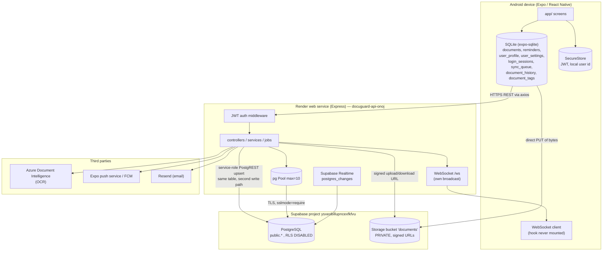

# DocuGuard — Production Data Flow and Recovery Audit

**Audit date:** 2026-10-21
**Audited tree:** repository `DocuGuard` at commit `602cc77` plus the uncommitted working-tree changes listed in Appendix A.
**Audit type:** Read-only. No application code, test, configuration, dependency, schema, migration, or environment variable was modified. No deployment, production write, database migration, restore, or APK build was performed.
**Method:** Static inspection of every server module, route, controller, service and migration; inspection of the canonical SQL schema; read-only inspection of the local (git-ignored) `DocuGuard-Server/.env`; execution of the two existing unit-test suites; inspection of the installed `pg` / `pg-connection-string` sources to establish the real TLS and precedence behaviour; and review of the repository's own record of live probes against the deployed service.

---

## Evidence labels used throughout

| Label | Meaning |
|---|---|
| **VERIFIED IN CODE** | Read directly in the repository at the cited `path:line`. The statement describes the code as it exists in this tree. |
| **VERIFIED BY USER-PROVIDED DASHBOARD EVIDENCE** | Established by the live probes recorded in this repository's own records (`docs/BACKEND_READINESS_INVESTIGATION.md`, §2), which were performed against the deployed Render service on 2026-10-21. |
| **DOCUMENTED BUT NOT VERIFIED** | Asserted by repository documentation or by configuration intent, but not confirmed by code inspection or by any live observation. |
| **UNKNOWN / REQUIRES MANUAL VERIFICATION** | Could not be determined from the repository. Needs access to the Render dashboard, the Supabase dashboard, or a live database. |

No secret value is reproduced anywhere in this document. Hostnames, project references, table names, column names, variable names and file paths are reproduced because they are necessary to identify the affected system; passwords, connection strings, tokens and keys are referenced only by variable name and are never printed.

---

## 1. Executive summary

### 1.1 What the system actually is

DocuGuard is an **offline-first Expo client backed by a single Express API and a single PostgreSQL database**. The mobile app keeps its own SQLite copy of documents, reminders, profile, settings, sessions and a sync queue (`services/localDatabase.ts:566-823`), and the Express service owns the server-side copy of the same records in PostgreSQL. There is **no second data store** and **no replication**: the "Supabase mirror" described in the code is a *second write path into the same tables of the same database*, not a copy (§4.3).

The file bytes live in Supabase Storage in a private bucket named `documents`; only the durable key (`documents.s3_key`) is stored in PostgreSQL, and every read mints a fresh 15-minute signed URL (`DocuGuard-Server/services/storageService.js:4-11,59-73`).

### 1.2 The database the code is configured to use

**VERIFIED IN CODE** — `DocuGuard-Server/config/db.js:4-9` resolves the connection in this order:

1. `DATABASE_URL` is used verbatim when set.
2. Only when `DATABASE_URL` is absent does the code build a URL from `DB_USER` / `DB_PASSWORD` / `DB_HOST` / `DB_PORT` / `DB_NAME` / `DB_SSL`.

**VERIFIED IN CODE (local configuration evidence)** — in the working copy of `DocuGuard-Server/.env`, `DATABASE_URL` **and** all six `DB_*` variables are set. `DATABASE_URL` points at the Supabase-managed PostgreSQL of project reference `ysxeobillupncexfkfvu` (host `db.ysxeobillupncexfkfvu.supabase.co`, port `5432`, database `postgres`, `sslmode=require`). The `DB_HOST` variable names the **same** host, so the fallback path would reach the same server even if it were taken. The `SUPABASE_URL` value resolves to the same project reference, i.e. **PostgreSQL, Storage and Realtime are all the same Supabase project.**

**UNKNOWN / REQUIRES MANUAL VERIFICATION** — the environment variables actually set on the Render service `docuguard-api-onoj` were not readable from the repository. `render.yaml:32-33` declares `DATABASE_URL` with `sync: false`, meaning it is set manually in the Render dashboard. The local `.env` is the best available evidence and is consistent with `APP_BASE_URL` pointing at the live service, but the Render dashboard remains the authority.

**DOCUMENTED BUT NOT VERIFIED** — `DEPLOYMENT.md:9-19` and `render.yaml:71-76` describe a *Render Managed PostgreSQL* named `docuguard-db` (database `docuguard`) as the primary database, with Supabase described as the secondary "cloud sync/exports" store. The deployed configuration does not follow that document: the primary connection string points at Supabase. Whether a `docuguard-db` instance still exists, and whether it holds a stale copy of the schema, is **UNKNOWN**.

### 1.3 Live status of the deployed service

**VERIFIED BY USER-PROVIDED DASHBOARD EVIDENCE** — on 2026-10-21T08:22Z, `GET https://docuguard-api-onoj.onrender.com/health` returned **HTTP 200** and `GET /health/ready` returned **HTTP 503** (`docs/BACKEND_READINESS_INVESTIGATION.md:56-60`). The process was alive and had passed boot-time environment validation, but it **could not reach its database**. The specific PostgreSQL error was never captured, because the Render log stream was not available at that time and the route logged only `error.message` (`docs/BACKEND_READINESS_INVESTIGATION.md:93-107`).

**VERIFIED IN CODE** — a structured, credential-sanitised readiness log was subsequently added (`DocuGuard-Server/app.js:78-107`, commit `602cc77`). It is **committed but the repository contains no evidence that it has been deployed**; the readiness investigation itself states the patch was "implemented but not deployed" (`docs/BACKEND_READINESS_INVESTIGATION.md:199`). Whether production now emits the diagnostic line is **UNKNOWN / REQUIRES MANUAL VERIFICATION**.

### 1.4 Headline conclusions

1. **There is no backup, restore, retention or disaster-recovery capability anywhere in the product.** The only "backup" is a one-way local JSON export (`services/backupService.ts:18-56`) with no import path. This is the single largest gap for an application whose entire purpose is long-lived custody of identity documents. (§5, P0-2)
2. **The "mirror" is a self-write with a data-destruction hazard.** Two call sites push *partial* document objects into the mirror; against the same physical table that is an upsert, this nulls `expiry_date`, `document_number`, `issuer`, `s3_key`, `file_url`, `risk_score` and `risk_level` on the authoritative row. (§4.3, P0-1)
3. **Row Level Security is explicitly disabled on all 15 tables** (`supabase-schema.sql:374-388`) while the same project exposes PostgREST and Storage. If the Supabase `anon` / `authenticated` roles retain the platform's default table grants, the anon key grants read/write on every table, including `users.password_hash` and `users.two_factor_secret`. The grant state of the live project is **UNKNOWN**. (§6.2, P0-3)
4. **The deployed service was failing its own readiness contract** on 2026-10-21, yet the platform health check points at the liveness route (`render.yaml:12`), so the instance stayed in service while every database-backed request failed. (§7, P0-4 / P2-1)
5. **There is no multi-role RBAC.** The authorisation model is strictly *user-scoped*: every server query filters on `user_id` taken from the signed JWT. The `role` claim that is signed into the token is never read by any code path, and the `users` table has no `role` column at all — which additionally breaks the API email-verification endpoint (`DocuGuard-Server/controllers/authController.js:293` selects a column that does not exist). (§6.1, P1-3)
6. **Two PII leaks in logs and exports**: the registration error path writes the plaintext password into the log stream and the debug log file (`authController.js:113-119`, `utils/errors.js:20-30`), and `GET /profile/export` returns the whole `users` row — password hash, 2FA secret, push tokens and verification token — to the device (`controllers/profileController.js:698-746`). (§6, P1-1, P1-2)
7. **Tests are real and green, but they are unit tests only.** 243 unit tests exist and all pass (80 backend + 163 client). None touches a real database, an HTTP boundary, the mirror path, or any backup/restore behaviour. The 163-test client suite is **not executed in CI**. (§8)
8. **The tree cannot be deployed as it stands.** 31 tracked paths are changed and every module they depend on — `shared/sync/`, `shared/dates/`, `tests/`, `services/syncWorker.ts`, `services/syncRetryStore.ts`, `services/documentSaveService.ts` — is **untracked**. Committing the tracked changes alone yields a server that throws `MODULE_NOT_FOUND` at boot and a mobile bundle that cannot resolve its imports, while CI stays green because the syntax check parses without executing `require`s. The live instance is unaffected today because it runs an older commit. (§9 P0-5)
9. **The client vault is push-only.** The app never downloads anything: the realtime hook is never mounted, the sync pass issues no `GET`, and `api.documents.getAll()` is never called. A reinstalled or second device therefore shows an **empty vault** while every document sits in the database, and a document added on one device is invisible on the others — with no backup either (finding 1), the user's only copy is unreachable through the product. (§4.2, §2.4, P0-6)

### 1.5 Findings at a glance

| Severity | Count | IDs |
|---|---|---|
| **P0 — Critical** | 6 | P0-1 … P0-6 |
| **P1 — High** | 7 | P1-1 … P1-7 |
| **P2 — Medium** | 7 | P2-1 … P2-7 |
| **P3 — Low** | 8 | P3-1 … P3-8 |
| **Total** | **28** | Full detail in §9 |

---

## 2. Architecture and data-flow map

### 2.1 Component map



### 2.2 Write paths, per flow

| Flow | Path | Evidence |
|---|---|---|
| **Register / login** | `POST /auth/register` → `INSERT INTO users` (bcrypt hash, `is_verified=false`, verification token) → `POST /auth/login` → `SELECT * FROM users WHERE email=$1` → bcrypt compare → TOTP gate → `jwt.sign({userId, role}, JWT_SECRET, {expiresIn:"7d"})` | `controllers/authController.js:62-73`, `:146-206` |
| **Email verification** | `POST /auth/verify-email` → single atomic `UPDATE users SET is_verified=TRUE, verification_token=NULL … WHERE verification_token=$1 AND verification_expires_at>NOW() AND is_verified=FALSE RETURNING id,email,role` | `controllers/authController.js:285-295` |
| **Document create (typed)** | `POST /documents` → `INSERT INTO documents … RETURNING …` → `syncDocument(...)` mirror | `controllers/documentController.js:782-815` |
| **OCR draft** | `GET /documents/upload-url` (signed upload URL) → client PUTs bytes to Storage → `POST /documents/ocr-draft` → ownership check on the key → `INSERT INTO documents (processing_status='pending')` | `controllers/documentController.js:136-182`, `:188-312`; `services/storageService.js:124-172` |
| **OCR processing** | `POST /documents/process` → mint fresh signed URL from `s3_key` → Azure `beginAnalyzeDocumentFromUrl` → `UPDATE documents … COALESCE(...)` (only fills empty fields) → `ocr_data` keeps the raw payload → mirror | `controllers/documentController.js:331-519`; `services/logicEngine.js:411-483` |
| **Document update (edit screen)** | `PUT /documents/:id` → conditional `UPDATE … WHERE id=$9 AND user_id=$10 AND (revision guard)` → 409 + `serverUpdatedAt` when the revision moved | `controllers/documentController.js:841-981` |
| **Client push sync** | `POST /documents/sync` → `resolveSyncTarget()` (cloudId → s3Key → documentNumber) → conditional `UPDATE` or `INSERT` → 409 on conflict | `controllers/documentController.js:984-1230`; `services/documentSyncResolver.js:40-125` |
| **Document delete** | `DELETE /documents/:id` → `DELETE FROM documents WHERE id AND user_id RETURNING s3_key` → best-effort `deleteStorageObject()` → `deleteRecord()` mirror delete | `controllers/documentController.js:1312-1348` |
| **Reminders** | `POST/PUT/DELETE /reminders` → `INSERT/UPDATE/DELETE FROM reminders WHERE user_id=$n` → `syncReminder()` / `deleteRecord()` mirror | `controllers/reminderController.js:41-224` |
| **Profile / preferences** | `PATCH /profile`, `/profile/preferences`, `/profile/security`, `/profile/settings`, `/profile/appearance`, `/profile/privacy` → `UPDATE users …` / `INSERT|UPDATE user_settings` → `syncProfile()` mirror | `controllers/profileController.js:192-255`, `:334-464`, `:519-691` |
| **Push token** | `POST /api/notifications/push-token` → transaction: detach the token from every other account, then `UPDATE users SET expo_push_token=…, fcm_token=…` | `routes/notification.js:20-94` |
| **Export** | `GET /profile/export` → `SELECT *` over six tables → JSON file download; `POST /api/export/export` → same data → `INSERT INTO exports (data JSONB)` | `controllers/profileController.js:694-751`; `services/supabaseSync.js:4-36` |
| **Account deletion** | `DELETE /profile` → one transaction deleting reminders, documents, user_settings, login_sessions, support_tickets, transactions, exports, users | `controllers/profileController.js:754-776` |
| **Expiration job** | `node-cron` "0 8 * * *" → one `SELECT` joining documents+users → push per row, concurrency 5 | `jobs/expirationChecker.js:28-96` |

### 2.3 Read paths

| Read | Route | Filter | Evidence |
|---|---|---|---|
| Document list | `GET /documents` | `user_id=$1 AND status <> 'deleted'` | `controllers/documentController.js:105-112` |
| Single document | `GET /documents/:id` | `id=$1 AND user_id=$2` | `:669-677` |
| Fresh file URL | `GET /documents/:id/file-url` | `id=$1 AND user_id=$2`, then sign `s3_key` | `:719-730` |
| Dashboard | `GET /dashboard` | documents `user_id=$1`, reminders `user_id=$1 AND is_read=FALSE` | `controllers/dashboardController.js:8-19` |
| Reminders | `GET /reminders` | `user_id=$1` | `controllers/reminderController.js:20-23` |
| Profile | `GET /profile` | `users.id=$1`; stats over `documents.user_id=$1` | `controllers/profileController.js:14-28` |
| Settings + sessions | `GET /profile/settings` | `user_settings.user_id=$1`, `login_sessions.user_id=$1` | `:337-354` |

Every server read is user-scoped. **No server read path returns another user's rows** — that part of the isolation model is consistent and correctly implemented.

### 2.4 Real-time paths — built, running server-side, and never consumed

Two independent real-time mechanisms exist on the server:

1. **Application broadcast over the server's own WebSocket** (`/ws`). The server pushes a synthetic event to that user after each write (`services/dataSyncService.js:55-59`, `:85-89`, `:109-113`). The WebSocket authenticates with a JWT **in the query string** (`services/realtimeService.js:41-43`).
2. **Supabase Realtime `postgres_changes`** subscriptions on `documents`, `reminders` and `profiles`, one channel per verified user, created at boot by `subscribeAllUsers()` (`services/realtimeService.js:71-142`, `:185-202`; `app.js:136-138`).

**Neither of them reaches the device.** The client-side consumer is `hooks/useRealtime.ts`, and **no screen mounts it**: a repository-wide search finds the identifier only at its own definition (`hooks/useRealtime.ts:43`) and nowhere in an import statement. The hook states this itself:

> *"The hook is implemented and the reconciliation it drives (`reconcileRealtimeDocument`, `reconcileRealtimeReminder`) is written and reviewed, but no screen mounts this hook, so no realtime message is received today and the reconciliation code does not run."* (`hooks/useRealtime.ts:29-32`)

The same comment then asserts that *"the sync worker remains the only path that brings server changes into the device"* (`hooks/useRealtime.ts:36-38`). **That assertion is not correct** — the sync worker only writes; see §4.2 and P0-6.

The reconciliation code itself (`services/localDatabase.ts:1068-1382`) is careful: it checks ownership, validates the `cloudId`, refuses to overwrite a row with pending local changes, and ignores an event that is not newer than the local copy. It is well written and it is **dead code**, because nothing calls it.

**What this actually costs:** the server opens a WebSocket endpoint and a per-user Supabase Realtime channel for every verified account, and emits two events per write into a void. The event volume is not doubled on the client — there is no client — but the server is paying the resource cost of a pipeline with no consumer, and the JWT-in-the-query-string transport (P2-3) is a latent rather than an active risk for as long as no client connects.

---

## 3. Database provider and connection precedence

### 3.1 The resolution algorithm (VERIFIED IN CODE)

`DocuGuard-Server/config/db.js:1-21`, reproduced in logic (not as a runnable connection string):

```
dotenv.config()                                  # line 2  — loads ./.env if present; never overrides real env vars
connectionString = process.env.DATABASE_URL      # line 4  — FIRST precedence
if (!connectionString && process.env.DB_HOST) {  # line 6  — fallback only
    ssl = (DB_SSL === "false") ? false : { rejectUnauthorized: false }      # line 7
    connectionString = "postgresql://" + enc(DB_USER) + ":" + enc(DB_PASSWORD)
                     + "@" + DB_HOST + ":" + (DB_PORT || 5432) + "/"
                     + (DB_NAME || "postgres") + "?sslmode=" + (ssl ? "require" : "disable")   # line 8
}
new Pool({
    connectionString,                            # line 12
    ssl: connectionString ? undefined : { rejectUnauthorized: false },   # line 14-16  (unreachable — see below)
    max: 10, idleTimeoutMillis: 30000, connectionTimeoutMillis: 10000  # lines 18-20
})
```

Consequences that follow directly from the code:

* **`DATABASE_URL` wins outright.** When it is set, `DB_HOST`, `DB_USER`, `DB_PASSWORD`, `DB_NAME`, `DB_PORT` **and `DB_SSL` are all ignored** — they are not merged, not used as fallbacks, not validated.
* `DB_SSL` is consulted **only** in the fallback branch, and only as an exact string comparison against `"false"`; `DB_SSL=0`, `DB_SSL=off`, `DB_SSL=OFF` and `DB_SSL=` (empty) all mean "SSL on".
* The `ssl: { rejectUnauthorized: false }` branch at `config/db.js:14-16` is **dead code**: `connectionString` is always truthy by the time the `Pool` is constructed, so `ssl` is always `undefined`. This is misleading but not a vulnerability — see §3.3.
* The password is URL-encoded when the fallback string is built (`encodeURIComponent`, line 8), so passwords containing `@`, `:`, `/` or `#` are handled correctly **in the fallback path only**.

### 3.2 Effective configuration of the deployed target (as far as it can be established)

| Variable | Set in local `.env` | Effective? | Notes |
|---|---|---|---|
| `DATABASE_URL` | yes | **YES — authoritative** | Points at `db.ysxeobillupncexfkfvu.supabase.co:5432/postgres`, `sslmode=require`. |
| `DB_HOST` | yes | no (shadowed) | Same host as `DATABASE_URL`; only used if `DATABASE_URL` is removed. |
| `DB_USER` | yes | no (shadowed) | — |
| `DB_PASSWORD` | yes | no (shadowed) | — |
| `DB_NAME` | yes | no (shadowed) | — |
| `DB_PORT` | yes | no (shadowed) | — |
| `DB_SSL` | yes (`true`) | no (shadowed) | Would only matter in the fallback path. |
| `SUPABASE_URL` | yes | yes | Same Supabase project as `DATABASE_URL`. |
| `SUPABASE_ANON_KEY` | yes | partly | A client is constructed with it (`config/supabase.js:10-13`) but **never used anywhere** in the codebase. |
| `SUPABASE_SERVICE_ROLE_KEY` | yes | yes | Used for every Supabase write, storage operation and Realtime subscription. |
| `SUPABASE_JWKS_URL` | yes | **never used** | No code path references it. Supabase Auth is **not** integrated — see §4.4. |
| `NODE_ENV` | `production` | yes | Drives the CORS fail-closed behaviour (`middleware/security.js:104-108`). |

> **UNKNOWN / REQUIRES MANUAL VERIFICATION.** The table above reflects the local working copy of `DocuGuard-Server/.env`, which is git-ignored (`.gitignore`, "Backend secrets" section) and therefore *not* the deployed configuration. The Render dashboard holds the deployed values (`render.yaml:13-69`, all `sync: false`). Confirm `DATABASE_URL`, `DB_*`, `SUPABASE_*` and `NODE_ENV` there before acting on §3.

### 3.3 Transport security of the database connection

Established by reading the installed dependency sources (`DocuGuard-Server/node_modules/pg` 8.22.0, `pg-connection-string` 2.14.0):

* `pg/lib/connection-parameters.js:59-61` — when `connectionString` is present, the parsed string **overrides** the options object.
* `pg-connection-string/index.js:77-79` — the presence of `sslmode` in the URL sets `config.ssl = {}`.
* `pg-connection-string/index.js:144-151` — for `sslmode=require` in the default (non-libpq-compat) path, `config.ssl` stays `{}`; a deprecation warning is emitted noting that `prefer`/`require`/`verify-ca` are currently aliases for `verify-full`.
* `pg/lib/connection-parameters.js:85` — `this.ssl = {}` (truthy) ⇒ **TLS is negotiated**, with Node's `tls.connect` defaults, i.e. `rejectUnauthorized: true` ⇒ the server certificate **is** verified against the system trust store and the hostname.

**Conclusion (VERIFIED IN CODE):** with the current `DATABASE_URL` (`…?sslmode=require`) the connection is encrypted and the server certificate is validated. The `{ rejectUnauthorized: false }` fallback in `config/db.js:14-16` never executes, so there is no silent MITM exposure today.

Two residual risks:

* If the connection string is ever rewritten **without** `sslmode` (or with `sslmode=disable`, which `DB_SSL=false` would produce in the fallback path), `config.ssl` becomes `false`/`undefined` and the session is opened in **plaintext**, carrying the password in the startup packet. This is a configuration landmine, not a current defect.
* `pg` emits a `process.emitWarning` deprecation notice for `sslmode=require`. In a future `pg` v9 / `pg-connection-string` v3 the semantics change to libpq-style, where `require` means *encrypt but do not verify the certificate*. Pinning the major version, or switching to `sslmode=verify-full` with a pinned CA, removes the ambiguity. (P3-1)

### 3.4 Boot-time validation

`DocuGuard-Server/config/env.js:10-57` fails fast (`process.exit(1)`) when `JWT_SECRET` is missing or shorter than 32 characters, when `SUPABASE_URL` or `SUPABASE_SERVICE_ROLE_KEY` is missing, or when **neither** `DATABASE_URL` **nor** `DB_HOST` is set. `app.js:30` calls it before the HTTP server is created.

Note the boundary: validation checks **presence**, not correctness, and it cannot detect a `DATABASE_URL` that points at the wrong instance, a wrong password, a host that does not resolve, or a host that is reachable but wrong. A server with a perfectly valid `DATABASE_URL` for the wrong database boots, serves `/health` with 200, and passes `/health/ready` with 200 — while writing into the wrong dataset. This is why `/health/ready` alone is insufficient (§7.3).

### 3.5 Documentation vs. configuration divergence

`DEPLOYMENT.md:9-19` and `render.yaml:71-76` describe a **Render Managed PostgreSQL** (`docuguard-db`, database `docuguard`, user `docuguard`) as the primary store, with Supabase as the secondary sync/export store. The deployed configuration points the primary connection at Supabase instead. Two consequences:

* **DOCUMENTED BUT NOT VERIFIED:** a Render-managed database may still exist with an older copy of the schema. Nothing in the code reads it, so it cannot cause a runtime fault, but it *is* a latent copy of PII in a second place.
* The runbook in `DEPLOYMENT.md:189-192` tells an operator to "verify `DB_SSL=true` for Render PostgreSQL" — advice that has no effect while `DATABASE_URL` is set, and would mislead exactly the person trying to fix the 503. (P3-1)

---

## 4. Entity ownership and synchronization matrix

### 4.1 Authoritative store per entity

| Entity | Authoritative store | Client copy | Server write path | Server read path | Mirror / second store | Divergence risk |
|---|---|---|---|---|---|---|
| **Users & credentials** | PostgreSQL `users` (`supabase-schema.sql:7-26`) | `user_profile` (partial: name, email, prefs) | `authController.js:62-73`, `:285-295`, `:584-587`; `profileController.js:566-570`, `:624-628`, `:681-685` | `authController.js:146-148`; `profileController.js:14-19` | `profiles` table mirror (`dataSyncService.js:92-114`) | Low for the server; the client's `user_profile` is a cache, and the server is never re-read for it on a schedule |
| **Profiles (display)** | PostgreSQL `users` | `user_profile` (`localDatabase.ts:708`) | `profileController.js:566-570` | `profileController.js:14-19` | `profiles` table mirror — **same `id`/`user_id`, so it is a second copy of the same facts** | Medium: `profiles` can disagree with `users` (the mirror only writes a subset of columns) |
| **Documents (metadata)** | PostgreSQL `documents` (`supabase-schema.sql:55-88`) | SQLite `documents` (`localDatabase.ts:571`) — **never refreshed from the server** (P0-6) | `documentController.js:249-302`, `:440-475`, `:782-809`, `:898-924`, `:1098-1134`, `:1167-1201` | `documentController.js:105-112`, `:669-677` | `documents` table mirror via PostgREST — **same table** | **High** — see §4.3 / P0-1, and the client copy never converges (P0-6) |
| **Document file bytes** | Supabase Storage bucket `documents` (private) | Local file URI until upload completes | Client `PUT` to a signed upload URL (`services/storageService.js:144-148`) | Server signs `s3_key` on every read (`storageService.js:59-73`) | none | Medium: orphan objects after a failed DB write (mitigated by `DELETE /documents/storage`, `documentController.js:1250-1309`) |
| **Reminders** | PostgreSQL `reminders` (`supabase-schema.sql:91-104`) | SQLite `reminders` (`localDatabase.ts:672`) — **never refreshed from the server** (P0-6) | `reminderController.js:55-60`, `:158-168` | `reminderController.js:20-23` | `reminders` table mirror — **same table** | Low for the mirror (the row is a faithful copy of itself), but the client copy diverges, and the server's reminder write has **no revision guard**, so two devices silently overwrite each other (P1-7) |
| **Notification preferences** | PostgreSQL `users.notifications_enabled / email_alerts / expiry_alerts` | `user_profile` + `user_settings` | `profileController.js:245-249`; `reminderController.js:126-129` | `profileController.js:14-19` | `profiles` mirror (subset) | Low |
| **Device push tokens** | PostgreSQL `users.expo_push_token / fcm_token` | Expo device token in memory | `routes/notification.js:63-78` (transactionally detached from other accounts first) | `documentController.js:492-495`, `:602-605`; `jobs/expirationChecker.js:32` | none | Low. Note: the `device_tokens` table (`supabase-schema.sql:107-114`) is **never referenced by any code** — dead schema |
| **Activity log** | PostgreSQL `activity_logs` (`supabase-schema.sql:129-135`) | none | `routes/subscription.js:124-142` **only** | never read | none | **The table is never written in production** — the only writer returns HTTP 503 when `NODE_ENV=production` (`routes/subscription.js:17-22`). No audit trail exists. |
| **Login sessions** | **Client only** (SQLite `login_sessions`, `localDatabase.ts:780-792`) | SQLite | client `addLoginSession` (`localDatabase.ts:2148`) | `GET /profile/sessions` reads the **server** table (`profileController.js:467-477`) | none | **High**: the server table (`supabase-schema.sql:200-210`) is only ever `SELECT`ed and `DELETE`d — there is **no `INSERT` anywhere in the repository**. The session list is therefore always empty, "terminate session" is a no-op, and a JWT cannot be revoked server-side. |
| **Settings** | PostgreSQL `user_settings` (`supabase-schema.sql:180-196`) | SQLite `user_settings` (`localDatabase.ts:759`) | `profileController.js:432-457` | `profileController.js:337-345` | none | Low |
| **Exports** | PostgreSQL `exports` (`supabase-schema.sql:170-175`) | JSON file on the device | `services/supabaseSync.js:27-29` | never read by the app | n/a | Medium: an unbounded, unencrypted JSONB copy of a user's data with no retention job |
| **Subscriptions** | PostgreSQL `subscriptions` (`supabase-schema.sql:117-126`) | client-side plan display | `routes/subscription.js:78-116` **only** | never read by the app | none | **The table is never written in production** (the route 503s in production). "Pro tier" is really `users.security_level` set by a mock checkout at `profileController.js:315-324`. |
| **OCR payload** | PostgreSQL `documents.ocr_data` JSONB | none | `documentController.js:454`, `:471` | not returned by the API | none | Contains the full recognised text of identity documents; no retention limit. |

### 4.2 Offline-first client architecture (VERIFIED IN CODE)

The device is the read source of truth for the user experience. The client stores documents, reminders, profile, settings, sessions, a sync queue, document history and tags in SQLite (`services/localDatabase.ts:566-823`). A `sync_queue` table (`localDatabase.ts:746-757`) records pending uploads, and `getUnsyncedDocuments()` / `getUnsyncedReminders()` / `getPendingSyncIds()` (`localDatabase.ts:2211-2312`) drive the push.

The server is the **arbiter** for the rows it holds: it is the only place that resolves "which row does this payload belong to" (`services/documentSyncResolver.js:40-125`) and the only place that arbitrates revisions. The **conflict policy is sound**: a 409 keeps the local copy, never overwrites either side, and reports the server revision for the user to decide (`services/syncService.ts:287-315`; `shared/sync/documentSyncCore.js:143-179`). A client that sends no revision gets an unconditional update (`documentController.js:868-895`), which is the documented backward-compatibility choice. The resolver is also careful about resurrection: a `cloudId` the server no longer owns is reported as a conflict, not re-inserted (`services/documentSyncResolver.js:49-66`).

**But the server is not a cross-device authority for the client, because the client never reads from it.** Every client read of application data comes from local SQLite — the document list, the dashboard, the reminders screen and the profile statistics all call `getAllDocuments()` / `getAllReminders()` (`app/(tabs)/documents.tsx:101`, `app/(tabs)/index.tsx:98-101`, `app/(tabs)/reminders.tsx:189`, `app/(tabs)/profile.tsx:310`). The sync pass performs **writes only** — `POST /documents/sync`, `DELETE /documents/:id`, `PUT`/`POST /reminders`, `PATCH /profile`, `PATCH /profile/preferences`, `POST /api/export/export` — and contains no `GET` at all (`services/syncService.ts:115-133`, `:203-525`). `api.documents.getAll()` exists (`services/api.ts:290-293`) and is **never called**; the only `GET`s the app issues are `/profile` (`app/(tabs)/profile.tsx:358`) and `/profile/sessions` (`:676`).

**The device vault is therefore push-only.** It converges with the server only for changes made on that device. (P0-6)

**Divergence that follows from this design:** an item in conflict stays queued and is **parked** — a 409 is classified `retryable: false, permanent: true` (`shared/sync/syncPolicy.js:84-95`), the local row is marked failed (`shared/sync/documentSyncCore.js:102-110`, `:168`), and `recordSyncFailure` sets `nextAttemptAt = null`, so the item is never attempted again automatically, not even with backoff (`shared/sync/syncPolicy.js:205-222`; `shared/sync/syncPolicy.js:303-309`). Only a forced pass — the manual "Sync now" — will attempt it again (`shared/sync/syncPolicy.js:284-297`). The server revision that caused the conflict is reported but **deliberately not stored locally**, because adopting it would make the next push compare against a revision the device never saw (`shared/sync/documentSyncCore.js:80-94`, `:143-149`); it therefore survives only in the in-memory `conflicts[]` array of the sync result (`services/syncService.ts:287-315`) and is lost when the app restarts.

**The client has a real retry subsystem — the strongest part of the codebase, and invisible from the server side (VERIFIED IN CODE).**

* A **background sync worker** (`services/syncWorker.ts`) is started at app start-up (`app/_layout.tsx:12`) and requested after every save (`app/add-document.tsx:38`). It polls every 5 minutes in the foreground (`services/syncWorker.ts:40`), enforces a 60-second floor between passes (`:37`), runs again whenever the app returns to the foreground (`:152-156`), and pushes documents **and** reminders (`:219-227`) — before this worker existed, `syncToCloud` was reachable only from the "Sync now" button.
* A **durable retry log** (`services/syncRetryStore.ts` → `shared/sync/syncRetryStore.js`) keeps per-record attempt state in AsyncStorage, deliberately outside the SQLite schema so it needs no migration and survives an app restart (`shared/sync/syncRetryStore.js:4-15`, `:27-46`).
* The **policy** (`shared/sync/syncPolicy.js:43-47`, `:162-222`) is explicit: exponential backoff from 30 s, doubling, capped at 30 minutes; a budget of **5 attempts** (`MAX_SYNC_ATTEMPTS = 5`), after which the record is *parked* (`permanent: true`) and only the user can release it. HTTP 400/404/401/403 are classified as **non-retryable** and parked immediately (`:96-144`); 5xx and network errors are retryable.
* Records blocked by an expired session are released on the next valid sign-in (`shared/sync/syncRetryStore.js:185-209`; `shared/sync/accountSwitch.js:62-69`).
* The log is pruned against the set of records that still exist (`services/syncWorker.ts:237-241`), so it cannot grow without bound.
* **A different account signing in purges the previous account's rows and empties the retry log before the new account can read anything** (`shared/sync/accountSwitch.js:72-83`, applied at `services/localDatabase.ts:421-431`). For a single-vault device this is the correct behaviour, and it is a genuine positive finding for the isolation model (§6.1).

**The one gap in the client subsystem:** a parked record — a conflict, a validation rejection, or an exhausted attempt budget — is never retried automatically. The count is reported to the user **after a sync pass** (`services/syncService.ts:255-260`, `:310-314`; `app/(tabs)/sync.tsx:169-171`), but because a parked record is not due, a pass that has nothing else to do will not re-surface it, and there is no persistent "items needing attention" screen. The retry store exposes `needsUserAttention()` (`shared/sync/syncRetryStore.js:86-89`), but no screen calls it. A parked item can therefore sit silently unsynchronised.

### 4.3 The "mirror" is not a mirror — and it can destroy data

**VERIFIED IN CODE.** `DocuGuard-Server/services/dataSyncService.js:43-60`:

```js
async function mirror(table, row, userId, event) {
  const { error } = await supabaseAdmin.from(table).upsert(row);   // line 44
  if (error) { console.error(`Supabase ${table} mirror failed`, …); }   // lines 45-51
  broadcastToUser(userId, table, { … });                          // lines 55-59
}
```

Three facts combine into a critical defect:

1. `supabaseAdmin` is the Supabase **service-role** client for project `ysxeobillupncexfkfvu` (`config/supabase.js:4-7`).
2. `DATABASE_URL` points at the **same** project's PostgreSQL (`db.ysxeobillupncexfkfvu.supabase.co`).
3. Therefore `supabaseAdmin.from("documents").upsert(row)` is an `INSERT … ON CONFLICT (id) DO UPDATE` against **the same `public.documents` table** the `pg` pool writes to — through PostgREST instead of through SQL, but the same rows.

A PostgREST upsert on conflict updates **every column present in the payload**, including explicit `null`s. The payload is built by `documentRow()` (`dataSyncService.js:6-28`), which coerces every absent field to a literal `null` (`issuer`, `document_number`, `issue_date`, `expiry_date`, `file_url`, `file_type`, `s3_key`, `risk_score`, `risk_level`) and `notes` to `""`.

Two call sites push a **partial** object into that path:

* `controllers/documentController.js:596-601` — *verify document* sends `{ id, userId, title, status:"verified" }`. The resulting upsert sets `status='verified'`, `category='other'`, `notes=''`, `processing_status='completed'` and **nulls `expiry_date`, `document_number`, `issuer`, `issue_date`, `s3_key`, `file_url`, `file_type`, `risk_score`, `risk_level`** on the authoritative row.
* `controllers/documentController.js:534-539` — *OCR failure* sends `{ id, status:"active", processing_status:"failed", user_id }`, whose missing `title` is coerced to the literal `"Scanned Document"` by `documentRow()` (`dataSyncService.js:7`), **overwriting the real document title** and nulling the same field set.

The full-object call sites (`:306`, `:482`, `:815`, `:958`, `:1158`, `:1207`) are faithful copies and are harmless.

**Impact if confirmed:** verifying a document or failing an OCR would erase the expiry date, document number, issuer and file reference of that document *in the only authoritative store*. The mobile client may still hold a copy, so the loss may be invisible until a device is reinstalled.

**There is a second, mutually exclusive failure mode.** If the live `DATABASE_URL` actually points somewhere other than the Supabase project — e.g. the Render-managed `docuguard-db` described in `DEPLOYMENT.md` — then the mirror is a genuine second store that (a) diverges permanently from the primary, (b) never receives the deletes performed by the primary (`deleteRecord()` is only ever called on the mirror, `documentController.js:1347`), and (c) receives only the *partial* rows described above. Either way the mirror design is unsound; which failure mode applies is **UNKNOWN / REQUIRES MANUAL VERIFICATION** and is the first item in the manual checklist (§10).

### 4.4 Supabase surface actually used

| Supabase capability | Used? | Evidence |
|---|---|---|
| **Auth** | **No** | `SUPABASE_JWKS_URL` is set in `.env`, `.env.example:50` and `render.yaml:40-41` but **no code references it**. Authentication is entirely custom: bcrypt + a locally signed JWT (`middleware/auth.js:22`, `controllers/authController.js:56-57`, `:200-206`). The `users` table is a plain table, not `auth.users`. Supabase Auth is therefore not the identity authority, and Supabase's session/ban/2FA features do not apply. |
| **PostgreSQL (via `pg`)** | **Yes — primary** | `config/db.js`, all controllers and services. |
| **PostgreSQL (via PostgREST / service role)** | **Yes — secondary write path** | `services/dataSyncService.js:44,73,93`; `services/supabaseSync.js:27,39`. |
| **Storage** | **Yes — file bytes** | `services/storageService.js:64,107,144`; private bucket `documents` (`supabase-schema.sql:411-413`). |
| **Realtime** | **Yes — server side; no client consumes it** | `services/realtimeService.js:79-132`; tables added to the `supabase_realtime` publication (`supabase-schema.sql:393-408`). The client hook is never mounted (§2.4, P0-6) |
| **Edge Functions / Cron / pg_cron** | No | — |
| **Client-side `supabase-js`** | **No** | The mobile app contains no `supabase-js` import and no Supabase URL/key; it talks only to the Express API (`services/api.ts:8-17`). The anon key is **not** shipped in the app bundle. The production API URL is hardcoded as a fallback at `services/api.ts:9` and `hooks/useRealtime.ts:57` (P3-8). |

### 4.5 Retry, conflict and failure handling

| Mechanism | Behaviour | Evidence |
|---|---|---|
| Server → mirror write | Fire-and-forget, **single attempt, no retry**; on error the failure is logged and swallowed; the request still returns 200 to the user | `services/dataSyncService.js:44-51` |
| Server → storage delete | Best-effort, logged, never retried; the document row is already gone, so the object is orphaned permanently | `services/storageService.js:104-121` |
| Server → storage signed URL | Throws on error; callers decide (list read falls back to the stale stored URL, `storageService.js:88-95`) | `services/storageService.js:59-73` |
| Client → server push | Queued in `sync_queue`; a background worker retries on a 5-minute poll; the manual "Sync now" action passes `force` and ignores the backoff | `services/syncService.ts:62-67`, `:250-252`; `services/syncWorker.ts:37-40`, `:117-150`; `services/localDatabase.ts:2211-2261` |
| Client → retry log | Durable per-record state in AsyncStorage: exponential backoff 30 s → 30 min, **5 attempts**, then parked (`permanent`) and never retried automatically; 4xx (400/401/403/404) park immediately, 5xx/network retry; auth-blocked records are released on the next sign-in; the log is pruned against surviving records | `shared/sync/syncPolicy.js:43-47`, `:96-153`, `:205-222`; `shared/sync/syncRetryStore.js:94-118`, `:137-168`, `:185-209`; `services/syncService.ts:308-312`, `:436-440`; `services/syncWorker.ts:237-241` |
| Conflict (409) | Local copy kept and the row marked failed; the record is **parked** (`permanent: true`, `nextAttemptAt = null`), so it is never retried automatically — only a forced "Sync now" attempts it again; the server revision is reported but **not persisted**, so the conflict's context is lost on restart | `shared/sync/syncPolicy.js:84-95`, `:205-222`, `:284-320`; `shared/sync/documentSyncCore.js:80-94`, `:143-179`; `services/syncService.ts:287-315`; `controllers/documentController.js:948-955`, `:1137-1151` |
| Revision guard | Microsecond-precision comparison for canonical revisions, millisecond for legacy clients; `clock_timestamp()` so two writes in one transaction get distinct revisions. **Documents only** — the reminder write path has no guard at all | `controllers/documentController.js:49-98`, `:1098-1106`; `controllers/reminderController.js:143-168` |
| Target resolution | `cloudId` → `s3Key` → `documentNumber` (+ title match), else insert. A `cloudId` the server no longer owns is a **conflict**, not a re-insert, so a document deleted elsewhere is not resurrected | `services/documentSyncResolver.js:40-125` |
| Realtime delivery | The server emits a WebSocket broadcast **and** a Supabase `postgres_changes` event per write, and **no client receives either** — `useRealtime` is never mounted. The reconciliation code (`services/localDatabase.ts:1068-1382`) is dead | §2.4 |
| Server → client pull | **Does not exist.** The sync pass issues no `GET`; `api.documents.getAll()` is never called. The vault converges only for changes made on the device that owns it | `services/syncService.ts:203-525`; `services/api.ts:290-293`; §4.2, P0-6 |
| Account switch on the device | A different account signing in purges the previous account's rows and empties the retry log before the new account can read anything; the same account keeps its unsynced rows and backoff | `shared/sync/accountSwitch.js:54-83`; `services/localDatabase.ts:421-431` |

**Consequence:** a transient Supabase/PostgREST failure does not fail the user-visible operation, but it *does* leave the mirror permanently inconsistent, with no repair job and no reconciliation pass anywhere in the repository. The client side is the opposite: it has a durable retry log, a bounded backoff and a parked-record state, so a client-side failure is recoverable by construction — which makes the absence of any equivalent on the server side more conspicuous, not less. The symmetry does not extend to the *direction* of travel, though: the client can repair a failed push, but it has no way to pull a server-side change at all (P0-6).

---

## 5. Backup and disaster-recovery assessment

### 5.1 What exists (VERIFIED IN CODE)

| Mechanism | Direction | Restorable? | Evidence |
|---|---|---|---|
| `exportLocalBackup()` — writes a JSON file of local documents/reminders/profile to the device's document directory and opens the share sheet | Device → file | **No import path exists anywhere in the repository** | `services/backupService.ts:18-56` |
| `exportDocumentArchive()` — a reduced JSON archive (metadata only, **no file bytes**) | Device → file | No | `services/backupService.ts:58-99` |
| `GET /profile/export` — a JSON download of six server tables for the calling user | Server → device | No | `controllers/profileController.js:694-751` |
| `POST /api/export/export` — the same data, additionally persisted as a JSONB row in `exports` | Server → server copy | The `exports` row is a *copy*, not a restore mechanism; nothing reads it back | `services/supabaseSync.js:4-36`; `routes/export.js:7-16` |
| `user_settings.auto_backup` | — | A user preference boolean with **no code path that acts on it** | `supabase-schema.sql:184`; `controllers/profileController.js:338,372,407,446` |

### 5.2 What does not exist

A repository-wide search for `pg_dump`, `pg_restore`, `snapshot`, `retention`, `PITR`, `point-in-time`, `RPO`, `RTO`, `disaster` and `recovery` returns **no** backup, retention, restore or disaster-recovery implementation, script, workflow, or runbook. The only hits are the `auto_backup` preference column and prose in `docs/CAPSTONE_OBJECTIVES_COMPLIANCE_AUDIT.md:240-251`, which itself records:

> "**No verified backup-and-restore process.** Export is one-way (local→file/share); there is no import/restore flow, no retention policy, no scheduled backup, no point-in-time recovery, and no evidence of a tested restore. Provider durability (Supabase) is not a verified backup-and-restore process." — `docs/CAPSTONE_OBJECTIVES_COMPLIANCE_AUDIT.md:248`

This audit **agrees with that assessment and does not soften it**: there is no evidence that any backup exists, that any backup is restorable, or that any restore has ever been performed. "The database is hosted by a managed provider" is durability, not backup, and it is not evidence.

### 5.3 Provider-level durability (UNKNOWN)

* **DOCUMENTED BUT NOT VERIFIED** — `DEPLOYMENT.md:211-219` prices the stack as Render Free Tier + Supabase Free Tier. Supabase Free Tier databases have automatic daily backups and a 7-day retention window, and are **paused after 7 days of inactivity**; Render Free Tier web services **spin down after 15 minutes of inactivity** and free PostgreSQL instances expire after 90 days (`DEPLOYMENT.md:215`). None of this is configured or asserted in code, and none of it was confirmed from the dashboards during this audit.
* **UNKNOWN / REQUIRES MANUAL VERIFICATION** — whether Supabase PITR is enabled, what the actual backup retention is, whether the project is currently paused, and whether a Render-managed `docuguard-db` still exists with a stale copy of the data.

### 5.4 Risk assessment

| Scenario | Current outcome | Evidence |
|---|---|---|
| Accidental `DELETE` of a document | Row deleted immediately; the storage object is removed on a best-effort basis; **no undo path** | `controllers/documentController.js:1312-1348` |
| Accidental table-level data loss (bad migration) | **Unrecoverable** — no dump, no snapshot, no PITR confirmed | §5.2 |
| Supabase project paused / unavailable | The API returns 503 on every database-backed request; the instance stays in service because the platform probes `/health` | `docs/BACKEND_READINESS_INVESTIGATION.md:56-60`; `render.yaml:12` |
| Supabase project deleted / credential rotated | **Total loss** of every user's documents, reminders and settings — the mobile client retains a local copy, so only a device reinstall or a new phone loses the data | §4.2 |
| Device lost | The server copy survives (if the database survives) — the *only* real recovery path in the product | §4.2 |

### 5.5 Recommended backup and recovery verification plan (proposed only — **not executed**)

> Nothing in this plan was run. It is written so an operator can execute it deliberately, in a controlled order, with a rollback at every step.

**Phase 0 — establish the facts (read-only, no data movement)**

1. In the Supabase dashboard, record: project region, plan, whether the project is paused, whether PITR is available on the plan, the backup retention window, and the pooler/direct connection strings.
2. In the Render dashboard, record: the deployed `DATABASE_URL` host and `DB_*` values (presence and host only — never paste the value into a ticket), the `SUPABASE_*` values, `NODE_ENV`, the deploy SHA, and the current health-check path.
3. Confirm whether a Render-managed `docuguard-db` still exists and, if so, its row counts per table (counts only, no rows).

**Phase 1 — take a verified first backup**

4. Using the Supabase SQL editor or `pg_dump` from a machine allowed by the provider, produce a **custom-format** dump to an access-controlled location, encrypted at rest, with the SHA-256 of the dump recorded in the same place as the runbook.
5. **Verify the dump is restorable** by restoring it into a *scratch* database (`supabase start`-style local Postgres or a separate throwaway project), then run a reconciliation query set against it and compare with the source:
   * row counts for `users`, `documents`, `reminders`, `profiles`, `user_settings`, `login_sessions`, `support_tickets`, `exports`;
   * `SELECT count(*) FROM documents WHERE user_id IS NULL OR title IS NULL OR expiry_date IS NULL;`
   * `SELECT id, count(*) FROM documents GROUP BY id HAVING count(*) > 1;` (duplicate detection)
   * a checksum over `documents(id, title, document_number, expiry_date, s3_key)`.
6. Record the elapsed time as the empirical RPO ceiling and the dump size as the basis for retention sizing. A backup that has not been restored is not a backup.

**Phase 2 — schedule and retain**

7. Enable provider-native daily backups with the longest retention the plan allows, and export a copy off-platform on a schedule.
8. Add an expiry policy for the copy — the copies contain unencrypted identity documents and must have a stated, enforced lifetime.
9. Add an alerting rule that fires when a backup job has not succeeded within its expected window, and a separate rule for "PITR is not enabled".

**Phase 3 — make recovery part of the product**

10. Add an **import** counterpart to `services/backupService.ts` (`importLocalBackup`), with schema versioning and a dry-run mode, so the existing export becomes an actual backup/restore pair.
11. Decide and document the authoritative source for restoration — server first, then device — and have the sync engine reconcile a restored device against the server by revision rather than by timestamp.
12. Write and rehearse the runbook: *PostgreSQL unreachable* (failover to the pooler / to a warm standby), *schema regression* (restore into a new database, repoint `DATABASE_URL`, re-run the app), *project pause* (resume, then verify with `/health/ready` and a row-count check).

**Phase 4 — prove it**

13. Twice a year, execute a full restore rehearsal in a scratch environment and record the measured RTO. Only a rehearsed restore counts as a recovery plan.

---

## 6. Security and privacy assessment

### 6.1 Authentication and authorization

**Model (VERIFIED IN CODE):** custom, single-role, JWT-based.

* Registration: bcrypt with cost 10 (`authController.js:56-57`), email uniqueness enforced by a check plus a `UNIQUE` constraint (`supabase-schema.sql:9`).
* Verification token: 32 random bytes, 24 h expiry, consumed atomically (`authController.js:59-60`, `:285-295`).
* Login: `SELECT * FROM users WHERE email=$1` → bcrypt compare → `is_verified` gate → TOTP gate → `jwt.sign({userId, role}, JWT_SECRET, {expiresIn:"7d"})` (`:146-206`).
* Password reset: token consumed inside a transaction with `SELECT … FOR UPDATE` (`:633-661`) — correct, and the only place in the codebase that uses `withTransaction` for a read-modify-write.
* Every protected route is behind `middleware/auth.js:5-40`, which verifies the token against `process.env.JWT_SECRET` and puts the decoded claims on `req.user`.

**Isolation (VERIFIED IN CODE):** every data-bearing query filters `user_id = req.user.userId` — see the read table in §2.3 and the write table in §2.2. This is consistently applied, including the delete paths (`documentController.js:1317-1320`, `reminderController.js:200-203`) and the storage-ownership check (`documentController.js:1262-1267`, `shared/sync/storageObjectPolicy.js`). **No cross-user read or write was found in the server code.**

**Device-side isolation is also handled correctly (VERIFIED IN CODE).** The device holds one vault, so signing in with a different account must not expose the previous account's rows. The policy decision (`shared/sync/accountSwitch.js:28-83`) distinguishes three cases — no owner yet, the same account, a different account — and for a different account it returns `purgePreviousData: true` and `clearRetryLog: true`. That decision is applied by the local database (`services/localDatabase.ts:421-431`), which refuses to continue if a purge is required but the owner cannot be established. The push token is detached from the previous account on sign-out (`app/(tabs)/profile.tsx:33`, `shared/sync/pushTokenOwnership.js`). This is a positive finding and it is worth preserving through any refactor of the sign-in path.

**There is no RBAC — and the role claim is decorative.**

* The JWT carries a `role` claim (`authController.js:201`, `:314`), but **no code path ever reads `req.user.role`** (a repository-wide search finds no read of it).
* The `users` table has **no `role` column** in `supabase-schema.sql:7-26` or in `DocuGuard-Server/migrations/001_add_settings_tables.sql:33-40`. `security_level` (`'Standard Tier'` / `'Pro Tier'`) is a display string, not an authorisation input.
* Consequence: `authController.js:285-295` executes `RETURNING id, email, role` — a column that does not exist in the canonical schema. If the live database matches the canonical schema, `POST /auth/verify-email` (the API/deep-link verification path) fails with a Postgres error and returns HTTP 500. The web path (`authController.js:423-433`) selects `id, email, name` and is unaffected. **Whether the live schema has a `role` column is UNKNOWN / REQUIRES MANUAL VERIFICATION**, but on the repository's own schema this endpoint is broken. (P1-3)
* `security_level` is escalated by a **mock** checkout that accepts a card number from the request body and stores only the last four digits (`profileController.js:292-331`). It is exposed at `POST /profile/subscription` in production (`routes/profile.js:16`) — there is no payment provider, and the endpoint grants `'Pro Tier'` without charging anything. (P1-4)

**2FA (VERIFIED IN CODE):** TOTP is implemented correctly — RFC 4648 base32, HMAC-SHA1, 6 digits, ±1 step window, constant-time comparison, fail-closed on a corrupt secret (`utils/totp.js:96-128`). Enrolment is staged: `two_factor_enabled_at` is set only after a valid code is presented (`profileController.js:179-182`), and the login gate requires **both** `two_factor_secret` and `two_factor_enabled_at` (`authController.js:178`). Gaps: the secret is stored in plaintext in `users.two_factor_secret`; a code can be replayed inside its 30-second step; and the 2FA attempt is bounded only by the generic auth limiter (10 attempts/hour/IP, `middleware/security.js:58-69`) — there is no per-account counter.

### 6.2 Database access and Row Level Security

**VERIFIED IN CODE — RLS is explicitly disabled on every table:**

```sql
ALTER TABLE users DISABLE ROW LEVEL SECURITY;        -- supabase-schema.sql:374
… 15 tables in total, through profiles …              -- supabase-schema.sql:374-388
```

The schema file documents the intent: *"The Express backend handles authentication via JWT. If you enable Supabase Auth later, add RLS policies below. For now, RLS is disabled so the backend can read/write normally."* (`supabase-schema.sql:369-373`).

This is acceptable **only** if the database is reachable solely by the server. The same Supabase project exposes PostgREST (`/rest/v1/*`) and Storage to the internet, and Supabase's platform default grants `anon` and `authenticated` privileges on `public.*`. With RLS disabled, a `SELECT` issued with the **anon key** can read every row of every table — including `users.password_hash`, `users.two_factor_secret`, `users.verification_token`, `users.fcm_token`, `documents.ocr_data` (the full OCR text of identity documents) and the `exports` table.

* The anon key is **not** embedded in the mobile app (the client never uses `supabase-js`, §4.4), which limits the exposure to "anyone who obtains the anon key" — a key that is designed to be public and is stored in the Render environment.
* The **live grant state is UNKNOWN / REQUIRES MANUAL VERIFICATION.** This must be checked before the system is exposed to any real user. (P0-3)
* The server's own connection uses the database's privileged role, so RLS would not protect it either way.

### 6.3 File storage access and signed URLs

**VERIFIED IN CODE — this is the strongest area of the implementation.**

* The bucket is forced private in the canonical schema: `INSERT INTO storage.buckets (id,name,public) VALUES ('documents','documents',FALSE) ON CONFLICT (id) DO UPDATE SET public = FALSE;` (`supabase-schema.sql:411-413`), with a documented fix for an existing public bucket (`supabase-schema.sql:308-311`).
* Object names are fully server-generated — `<userId>/<uuid><ext>` — precisely to defeat path traversal (`storageService.js:141-142`).
* Downloads are signed on demand with a **15-minute TTL** (`storageService.js:11`, `:64-66`); the persisted `file_url` is explicitly treated as a cache, not the source of truth (`supabase-schema.sql:69-71`).
* Uploads use a signed upload URL with `upsert: false` (`storageService.js:144-148`), so a client cannot overwrite an existing object.
* The file-type allow-list is narrow (PDF/JPEG/PNG/WebP/HEIC/HEIF) with a 15 MB cap (`storageService.js:20-29`), and the OCR draft route independently re-validates the key format and ownership before accepting it (`documentController.js:212-235`).
* Every read path re-signs: `rehydrateFileUrls()` (`storageService.js:82-98`) and `GET /documents/:id/file-url` (`documentController.js:714-753`).

**Residual risks:**

1. **Legacy rows may still carry a permanent public object URL in `documents.file_url`.** `rehydrateFileUrls()` falls back to the stored value when signing fails (`storageService.js:88-95`), and `getDocumentFileUrl()` returns the stored URL verbatim for rows without an `s3_key` (`documentController.js:733-737`). For rows created before the signed-URL change, that stored value was a public object URL — i.e. permanent public access to an identity document for anyone holding it. Whether such rows exist in the live database is **UNKNOWN**. (P2-2)
2. `createOcrDraft` calls `getSignedDownloadUrl()` purely to confirm the object exists (`documentController.js:239-247`) — it does not verify that the object is *the one the client just uploaded* beyond the key format. Acceptable given the key is server-generated, but worth noting.
3. Orphaned objects (upload succeeded, DB write failed) are only removed if the client calls `DELETE /documents/storage`; the server has no sweeper job.

### 6.4 Secret handling

**VERIFIED IN CODE / VERIFIED BY REPOSITORY STATE:**

* `DocuGuard-Server/.env` and `DocuGuard-Server/config/serviceAccountKey.json` are **git-ignored** (`.gitignore`, "Backend secrets") and **not tracked by git** — confirmed with `git ls-files --error-unmatch` (both paths errored as unknown to git). CI enforces this on every push: `.github/workflows/verify.yml:43-48` fails the build if any `.env`, `serviceAccountKey.json`, `.pem` or `.key` is tracked.
* Secrets are read from the environment only: `JWT_SECRET`, `SUPABASE_*`, `AZURE_*`, `FIREBASE_*`, `RESEND_API_KEY` (`config/env.js:10-37`, `config/firebase.js:16-24`, `config/email.js:6-17`, `services/logicEngine.js:6-7`).
* `JWT_SECRET` is required to be ≥ 32 characters (`config/env.js:19-24`).
* `config/firebase.js:26-32` throws a *named-variable* error when the service account is missing, instead of a `TypeError` — good diagnostics, and it fails loudly at boot rather than silently disabling push.
* The readiness route sanitises connection strings and password fragments out of its diagnostic log (`app.js:78-83`), covered by 11 unit tests (`tests/healthReady.test.js`).
* The client ships **no** key material; the only embedded endpoint is the public API base URL (`app.json:82`, `services/api.ts:8-9`).

**Gaps:**

* `DocuGuard-Server/config/serviceAccountKey.json` **exists in the working tree** (untracked, ignored). It must never be deployed or copied; confirm the Render build does not include it and rotate the key if it ever was.
* The pool error handler logs the raw error object (`config/db.js:23-25`), which is inconsistent with the sanitised readiness logging and may include a hostname or username. (P3-4)
* The **WebSocket JWT travels in the query string** (`services/realtimeService.js:41`), so it can appear in proxy and access logs. (P2-3)

### 6.5 Logging and sensitive-data exposure

**P1-1 — the plaintext password is written to the log stream.** The registration error handler logs the whole request body:

```js
logError("Auth", "Registration error",
  { error: err.message, stack: err.stack, body: req.body },   // authController.js:113-119
  ErrorCodes.AUTH_REGISTER_FAILED);
```

`req.body` for `POST /auth/register` is `{ name, email, password }` — the **plaintext password**. `logError` writes it to `console.error` **and** appends it to `DEBUG_LOG_FILE` (`utils/debugLogger.js:26-44`), which `render.yaml:68-69` sets to `/tmp/docuguard_debug.log` on the Render instance. The centralised error handler repeats the problem for any error that reaches it: `body: req.body` (`utils/errors.js:20-30`). The same handler also logs `req.query` and `req.params`.

**P1-2 — the account export returns the credential columns.** `GET /profile/export` runs `SELECT * FROM users WHERE id = $1` (`controllers/profileController.js:698-702`) and puts the whole row into the response, which the client writes to a file on the device. That row contains `password_hash`, `two_factor_secret`, `two_factor_enabled_at`, `fcm_token`, `expo_push_token`, `verification_token` and `verification_expires_at` (`supabase-schema.sql:7-26`). The narrower `services/supabaseSync.js:15-18` export path selects only `id, name, email, security_level, created_at` — the correct pattern, which shows the wide `SELECT *` is an oversight rather than a decision.

**Other logging observations:**

* `debugLogger` writes a persistent, unencrypted file on the instance disk containing user e-mail addresses, document titles, storage keys and, per P1-1, passwords. There is no rotation, no size cap and no purge job. (P2-4)
* `utils/errors.js:24` omits the stack unless `NODE_ENV === "development"` — correct for production.
* `jobs/expirationChecker.js:70-72` logs document ids and error strings, not user data. Acceptable.
* `services/logicEngine.js:422,494-501` logs the OCR URL (a **signed storage URL**, i.e. a bearer-equivalent credential for that document) and the extracted document number, issuer and dates to the console. (P2-5)

### 6.6 Privacy inventory

| Data | Where it lives | Retention control |
|---|---|---|
| Identity documents (metadata) | `documents` | none (retained until the user deletes) |
| Identity documents (bytes) | Supabase Storage, private bucket | none; orphans and files of deleted accounts are never swept |
| Raw OCR text of identity documents | `documents.ocr_data` JSONB | none |
| Password hashes | `users.password_hash` | — |
| 2FA shared secret | `users.two_factor_secret`, **plaintext** | — |
| Email verification token | `users.verification_token`, plaintext | cleared on success (`authController.js:288-289`); a stale token survives if the user never verifies |
| Password-reset tokens | `password_resets.token` plaintext | marked `used` but **never deleted**; no expiry sweep |
| Push tokens | `users.fcm_token`, `users.expo_push_token` | cleared on sign-out (`routes/notification.js:108-139`) |
| Full account export | `exports.data` JSONB, unbounded | none; deleted only when the account is deleted |
| Logs | `/tmp/docuguard_debug.log` | none |

**P1-6 — account deletion leaves the files behind.** `deleteAccount()` removes eight tables in one transaction (`controllers/profileController.js:760-770`) but never calls `deleteStorageObject()`. The row that points at each object is deleted, so the object becomes permanently unreachable *and* permanently retained: the exact "orphaned PII" state the code elsewhere works to avoid (`documentController.js:1331-1345`).

---

## 7. Health and readiness assessment

### 7.1 The two endpoints (VERIFIED IN CODE)

**`GET /health` — liveness** (`DocuGuard-Server/app.js:57-59`):

```js
app.get("/health", (req, res) => {
  res.json({ status: "ok", timestamp: new Date().toISOString() });
});
```

No database, no dependency, no work. It returns 200 as long as the Node event loop is alive.

**`GET /health/ready` — readiness** (`DocuGuard-Server/app.js:85-107`):

```js
app.get("/health/ready", async (req, res) => {
  try {
    await db.query("SELECT 1");
    res.json({ status: "ready", database: "ok", timestamp: … });
  } catch (error) {
    console.error("Readiness check failed:", {
      name: error.name, code: error.code, errno: error.errno,
      message: sanitizeErrorMessage(error.message),
    });
    res.status(503).json({ status: "not_ready", database: "unavailable", … });
  }
});
```

The query goes to the same `pg` pool the application uses (`config/db.js:11-21`), so it exercises the real connection parameters, the real credentials, the real TLS negotiation and the real network path — subject to the 10 s `connectionTimeoutMillis`.

**A note on ordering.** `app.use(apiLimiter)` is registered at `app.js:54`, *before* the health routes at `:57` and `:85`, so **both health endpoints are subject to the global rate limiter** (300 requests / 15 min / user-or-IP, `middleware/security.js:44-55`). The statement in `docs/BACKEND_READINESS_INVESTIGATION.md:17` that `/health` is "Registered before rate limiters so probes are not throttled" is **stale with respect to the current source** and should be corrected. The current budget is ample for a platform probe, but it is a shared bucket with real traffic from the same IP.

### 7.2 Observed production behaviour

**VERIFIED BY USER-PROVIDED DASHBOARD EVIDENCE** — 2026-10-21T08:22Z: `/health` → **200**, `/health/ready` → **503** (`docs/BACKEND_READINESS_INVESTIGATION.md:56-60`). The service was running and correctly configured at boot (boot validation calls `process.exit(1)` on a missing variable, `config/env.js:42-57`), yet could not reach its database. The exact error was not captured: the Render log stream was unavailable and the route at that time logged only `error.message` (`docs/BACKEND_READINESS_INVESTIGATION.md:93-107`).

**Candidate causes, ranked, all UNCONFIRMED** (`docs/BACKEND_READINESS_INVESTIGATION.md:93-103`):

| # | Hypothesis | Why it fits the evidence | How to confirm |
|---|---|---|---|
| H1 | **IPv6-only direct connection.** `DATABASE_URL` uses the *direct* host `db.<ref>.supabase.co`, not the pooler. On many Supabase projects the direct host resolves to IPv6 only. Render's free tier has no IPv6, so the TCP connect fails. | Matches "process alive, DB unreachable" exactly, and is the most common cause of this symptom on Supabase-direct + Render. | Render log `error.code` = `ENETUNREACH` / `EAI_AGAIN`; `dig A db.<ref>.supabase.co` vs `dig AAAA …`; Supabase → Database → Connection string → "IPv4" toggle. |
| H2 | **Supabase project paused** (free tier pauses after 7 days of inactivity). | The API answers 503 for database requests while the process stays up. | Supabase dashboard → project status; pause/resume notice. |
| H3 | Credential mismatch (`DATABASE_URL` points at a role that was rotated or a different project). | Presence-validated but not correctness-validated (`config/env.js:27-31`). | Render log `error.code` = `28P01`; compare the project ref in `DATABASE_URL` with `SUPABASE_URL`. |
| H4 | DNS failure from the Render egress. | `getaddrinfo ENOTFOUND`. | Render log `error.code` = `ENOTFOUND`. |
| H5 | Pool exhaustion (10 connections) — unlikely for a single `SELECT 1`. | `max: 10`, `idleTimeoutMillis: 30000`. | Render log would show a queue-timeout message. |
| H6 | The 10 s `connectionTimeoutMillis` expiring on a slow egress. | `config/db.js:20`. | Render log `error.code` = `ETIMEDOUT`. |

The committed diagnostic patch (`app.js:78-107`) makes each of these distinguishable from the log line alone — but only once it is deployed. **Deploying it and reading one log line is the single highest-value next action**; no code change is required for that.

### 7.3 What a successful readiness check does and does not establish

**A 200 from `/health/ready` establishes:**
* the process is alive and the HTTP stack is serving;
* boot-time environment validation passed (so `JWT_SECRET`, `SUPABASE_URL`, `SUPABASE_SERVICE_ROLE_KEY` and one of `DATABASE_URL`/`DB_HOST` are present);
* a `pg` client can open a connection to **the host in the connection string**, complete the TLS handshake, authenticate, and execute `SELECT 1` within 10 s.

**A 200 does *not* establish:**
* that the schema exists — `SELECT 1` touches no table, so a missing `documents` column or a missing table still reports "ready";
* that the connection points at the *intended* database — a `DATABASE_URL` for the wrong project also returns "ready";
* that RLS/grants are correct, or that the anon role is not able to read the tables (§6.2);
* that Supabase Storage, Realtime, Expo push, Azure OCR or Resend are reachable — none is probed;
* that the `pg` pool has capacity for real traffic (one connection is checked, `max` is 10);
* that the cron job will run (`node-cron` in-process, `jobs/expirationChecker.js:96` — and on Render Free Tier it only fires while the instance is awake);
* that the running build matches the audited source — a redeploy of an older commit would report "ready" identically;
* that the data is intact — a logically corrupted or truncated table still answers `SELECT 1`;
* that any backup exists (§5).

### 7.4 A prior failure does not imply a later success — or vice versa

The readiness check is **per-request and stateless**; nothing in the codebase caches a readiness verdict, and `pool.on("error")` only logs idle-client errors (`config/db.js:23-25`). Therefore:

* the 503 observed on 2026-10-21 says nothing about whether a request made before or after that moment would have succeeded — the pool reconnects, DNS changes, Supabase resumes, and each attempt is independent;
* a future 200 would say nothing about the *next* request: the same host can become unreachable again (network, pause, credential rotation, IPv6 routing), and the readiness route has no memory;
* conversely, a single 200 must not be read as "the database problem is fixed". The root cause of the observed 503 is **still UNCONFIRMED** and, on the evidence in §7.2, is most likely environmental (H1/H2) rather than a code defect — the code path is behaving exactly as designed.

### 7.5 Platform health check

**VERIFIED IN CODE** — `render.yaml:12` sets `healthCheckPath: /health`. Render therefore judges the instance healthy on **liveness alone**. A total database outage leaves the instance in service, in the load-balancer rotation, serving 500s to every authenticated request. This is the mechanism that turned a database outage into a user-visible outage on 2026-10-21 without any platform-level alarm. (P2-1)

---

## 8. Test coverage and evidence

### 8.1 Test results actually obtained in this audit

Both suites were executed locally on **2026-10-21** from the audited tree. No network calls were made by the tests; all database access is stubbed. The results below are the verbatim `node --test` tallies.

**Backend — `npm --prefix DocuGuard-Server test` (`node --test "tests/*.test.js"`)**

| Test file | Tests | Pass | Fail |
|---|---:|---:|---:|
| `DocuGuard-Server/tests/documentSync.test.js` | 9 | 9 | 0 |
| `DocuGuard-Server/tests/email.test.js` | 17 | 17 | 0 |
| `DocuGuard-Server/tests/healthReady.test.js` | 11 | 11 | 0 |
| `DocuGuard-Server/tests/notificationDelivery.test.js` | 5 | 5 | 0 |
| `DocuGuard-Server/tests/preferences.test.js` | 6 | 6 | 0 |
| `DocuGuard-Server/tests/storageService.test.js` | 8 | 8 | 0 |
| `DocuGuard-Server/tests/totp.test.js` | 10 | 10 | 0 |
| `DocuGuard-Server/tests/validation.test.js` | 14 | 14 | 0 |
| **Total (8 files)** | **80** | **80** | **0** |

**Client — `npm test` at the repository root (`node --test "tests/*.test.js"`)**

| Test file | Tests | Pass | Fail |
|---|---:|---:|---:|
| `tests/accountSwitch.test.js` | 6 | 6 | 0 |
| `tests/cloudId.test.js` | 7 | 7 | 0 |
| `tests/documentPayload.test.js` | 11 | 11 | 0 |
| `tests/documentSaveCore.test.js` | 7 | 7 | 0 |
| `tests/documentSyncCore.test.js` | 12 | 12 | 0 |
| `tests/documentSyncResolver.test.js` | 7 | 7 | 0 |
| `tests/localDatabase.sqlite.test.js` | 10 | 10 | 0 |
| `tests/offlinePersistence.test.js` | 4 | 4 | 0 |
| `tests/payloadContract.test.js` | 4 | 4 | 0 |
| `tests/pushTokenOwnership.test.js` | 8 | 8 | 0 |
| `tests/reminderSchedule.test.js` | 15 | 15 | 0 |
| `tests/revisionCompatibility.test.js` | 9 | 9 | 0 |
| `tests/revisionConcurrency.test.js` | 7 | 7 | 0 |
| `tests/syncPolicy.test.js` | 18 | 18 | 0 |
| `tests/syncRetryStore.test.js` | 7 | 7 | 0 |
| `tests/syncWorker.test.js` | 13 | 13 | 0 |
| `tests/uploadCompensation.test.js` | 6 | 6 | 0 |
| `tests/validationContract.test.js` | 5 | 5 | 0 |
| `tests/validationSchemas.test.js` | 7 | 7 | 0 |
| **Total (19 files)** | **163** | **163** | **0** |

**Combined: 243 tests, 243 passing, 0 failing.** Both suites also exit cleanly (no open handles), and the backend suite is hermetic — `db.query` is replaced with a stub in every test that touches the database (`tests/healthReady.test.js:109-142`, `tests/documentSync.test.js:71-102`, `tests/preferences.test.js:45-70`, `tests/notificationDelivery.test.js:64-87`). **No test in this repository has ever opened a connection to a real database.**

### 8.2 What the tests actually cover

| Area | Covered | Not covered |
|---|---|---|
| **Readiness route** | 200/503 status mapping, response body shape, log redaction of connection strings and passwords, omission of stack traces, `code`/`errno` absent → `undefined` (`tests/healthReady.test.js`, 11 tests) | Any real connection; the actual TLS handshake; the pool under load; the platform health-check path (`/health` has **no test at all**) |
| **Sync target resolution** | `cloudId` → `s3Key` → `documentNumber` precedence, conflict on a mismatched title, `notOwned` conflict (`tests/documentSyncResolver.test.js`, `tests/documentSync.test.js`) | The behaviour when the resolved row is deleted between resolution and update |
| **Revision/conflict protocol** | Microsecond vs millisecond comparison, legacy-client compatibility, concurrency (`tests/revisionCompatibility.test.js`, `tests/revisionConcurrency.test.js`) | Cross-process concurrency; the real Postgres `date_trunc` behaviour (the SQL is string-built, never executed against a database) |
| **Local persistence** | SQLite schema creation, account switching, purge on sign-out, `sync_queue` behaviour (`tests/localDatabase.sqlite.test.js`, `tests/offlinePersistence.test.js`, `tests/accountSwitch.test.js`) | The real `expo-sqlite` native module (the test uses an in-memory substitute) |
| **Sync worker / retry** | Backoff, retry budget, worker lifecycle (`tests/syncWorker.test.js`, `tests/syncRetryStore.test.js`) | Retry behaviour against the real server; the interaction with the server's 409 responses |
| **Push-token ownership** | A token is detached from the previous account (`tests/pushTokenOwnership.test.js`) | The server transaction that implements it (`routes/notification.js:35-79` is untested) |
| **Notification delivery** | The expiration query's filters and the batching (`tests/notificationDelivery.test.js`) | The actual Expo/FCM delivery |
| **Preferences** | Only the supplied preference is written (`tests/preferences.test.js`) | The mirror write |
| **Validation** | Zod schemas on both sides (`tests/validation.test.js`, `tests/validationContract.test.js`, `tests/validationSchemas.test.js`) | — |
| **Storage service** | File-type allow-list, key generation, URL rehydration (`tests/storageService.test.js`) | The real Supabase Storage API |
| **Email** | Link construction, HTML escaping, XSS payloads (`tests/email.test.js`) | Actual delivery |

### 8.3 Coverage gaps that matter for this audit

1. **No integration test** exercises a route end-to-end through HTTP with a real database — the `pg` pool is stubbed in every backend test. Ownership filtering, the revision guard SQL, `RETURNING id, email, role` and the mirror path are therefore never executed by a test.
2. **The mirror path has no test.** `services/dataSyncService.js` is not imported by any test, which is why the partial-row defect in §4.3 has gone unnoticed.
3. **No backup, restore, retention or export-import test exists.** `docs/CAPSTONE_OBJECTIVES_COMPLIANCE_AUDIT.md:246` already records "Tests: None for backup/restore".
4. **The client suite is not run in CI.** `.github/workflows/verify.yml:34-48` runs `npm run typecheck`, the backend syntax check, the backend tests and the secret-tracking check — it never invokes the root `npm test`. 163 of the 243 tests are therefore not enforced on any push. (P2-7)
5. There is no test for `/health` (liveness) and no test that asserts the Render health-check path is the one that should be used.
6. **No CI step loads the application.** The syntax check parses files without executing their `require`s (`DocuGuard-Server/scripts/checkSyntax.js:58`), and none of the five tracked backend test files imports a controller — so a missing module, a circular import or a boot-time throw passes CI and fails only in production. This is the gap that let P0-5 reach a committable state undetected.
7. **The CI jobs never see the untracked part of the tree.** The three backend test files that would exercise the new sync paths (`documentSync.test.js`, `notificationDelivery.test.js`, `preferences.test.js`) and all 19 client test files are untracked, so a CI run of the tracked tree is exercising roughly half of the suite that the working tree actually contains.
8. **The client-side real-time path is untested because it is not mounted.** The reconciliation functions `reconcileRealtimeDocument` / `reconcileRealtimeReminder` (`services/localDatabase.ts:1068-1382`) are careful — ownership check, `cloudId` validation, "the local row has pending changes", "the remote row is not newer" — and no test exercises them, because no screen mounts `hooks/useRealtime.ts`. The hook's own comment says the reconciliation "has to be covered by tests before it goes live" (`hooks/useRealtime.ts:40-42`), so the gap is known and intentional; it is recorded here because the consequence is P0-6, not because the code is wrong.
9. **No test covers a server→client data transfer, because none exists.** The suite exercises push, conflict detection, backoff and the retry budget, but nothing asserts that the client can obtain a document it did not create — the capability that is missing (P0-6).

---

## 9. Prioritized findings and recommended actions

Each finding lists evidence, impact, the recommended action, and a verification procedure that can be executed without touching production data.

### P0 — Critical

---

#### P0-1 — The "mirror" writes partial rows back into the authoritative `documents` table and can erase document data

**Evidence (VERIFIED IN CODE)**
* `DocuGuard-Server/services/dataSyncService.js:6-28` — `documentRow()` coerces every absent field to an explicit `null` (`issuer`, `document_number`, `issue_date`, `expiry_date`, `file_url`, `file_type`, `s3_key`, `risk_score`, `risk_level`) and `notes` to `""`; a missing `title` becomes the literal `"Scanned Document"`.
* `DocuGuard-Server/services/dataSyncService.js:43-60` — `mirror()` performs `supabaseAdmin.from(table).upsert(row)`; a PostgREST upsert on conflict updates every column present in the payload, including explicit nulls.
* `DocuGuard-Server/config/supabase.js:4-7` — the mirror client is the **service-role** client for project `ysxeobillupncexfkfvu`.
* `DocuGuard-Server/.env` — `DATABASE_URL` points at `db.ysxeobillupncexfkfvu.supabase.co`, the **same project's** PostgreSQL. `docs/schema_note.md:3` independently confirms the design intent: *"Supabase mirror writes to same-named table."*
* Two call sites send **partial** objects: `DocuGuard-Server/controllers/documentController.js:596-601` (verify) and `:534-539` (OCR failure).
* Mirror failures are swallowed (`services/dataSyncService.js:45-51`), and no test imports this module.

**Impact**
If the mirror and the primary pool address the same table, then *verifying a document* or *failing an OCR* nulls the document's `expiry_date`, `document_number`, `issuer`, `issue_date`, `s3_key`, `file_url`, `file_type`, `risk_score` and `risk_level`, resets `category` to `"other"`, blanks `notes`, and (on the OCR-failure path) replaces the title with `"Scanned Document"` — **in the only authoritative store**. Expiry monitoring then stops working for that document, the file reference is lost, and the client may still show stale correct data until the device is reinstalled. If the mirror instead addresses a different database, the two stores diverge permanently with no reconciliation job, and deletes applied to the primary are never applied to the mirror.

**Recommended action**
1. Treat the mirror as **the** second write path and fix it first, or remove it. If it is removed, the application must still deliver real-time updates — the server's own WebSocket broadcast already does that (`services/dataSyncService.js:55-59`), and the Supabase `postgres_changes` subscription becomes redundant because the rows are the same rows.
2. If it is kept, it must write to a table that is **not** the authoritative one, or write only a strictly-owned subset of columns, and it must never send a `null` for a field it does not own. A partial-object call site must be fixed first.
3. Make mirror failures observable: return them in the API response, count them, and alert — a silently swallowed write is indistinguishable from success.
4. Add a reconciliation job that compares the two sources row by row and reports drift.

**Verification procedure**
1. Determine the truth: in the Render dashboard, read the deployed `DATABASE_URL` **host** (not the value) and compare it with the host in `SUPABASE_URL`. If they are the same project, the mirror is a self-write.
2. On a **non-production copy** of the schema, insert a document with all fields populated, then issue the exact `verify` request and re-read the row; compare every column.
3. In the live database (read-only), count the damage with:
   `SELECT status, count(*) FILTER (WHERE expiry_date IS NULL) AS no_expiry, count(*) FILTER (WHERE s3_key IS NULL) AS no_file, count(*) FROM documents GROUP BY status;`
   and list the most recently verified documents with their `updated_at`.
4. If any verified document has a null `expiry_date` and a non-null `created_at` older than the verification, the defect has already fired in production.

---

#### P0-2 — There is no backup, retention, restore or disaster-recovery capability

**Evidence**
* No `pg_dump`, `pg_restore`, snapshot, retention, PITR, RPO, RTO or recovery code, script, workflow or runbook exists anywhere in the repository (repository-wide search, §5.2).
* `services/backupService.ts:18-56` exports to a JSON file with **no import counterpart**.
* `DocuGuard-Server/routes/export.js:7-16` and `controllers/profileController.js:694-751` export; nothing imports.
* `supabase-schema.sql:184` — `auto_backup BOOLEAN DEFAULT TRUE` is a preference that drives no code.
* `docs/CAPSTONE_OBJECTIVES_COMPLIANCE_AUDIT.md:248` already records: *"No verified backup-and-restore process."*
* `DEPLOYMENT.md:211-219` prices the stack on free tiers with a 90-day expiry for the Render database and a 7-day inactivity pause for Supabase — neither is a backup.

**Impact**
The product's entire purpose is long-term custody of identity documents, and the only copy that survives a device loss is a database with no backup, no tested restore, and no stated retention. A single bad migration, a credential rotation, a project pause or a project deletion is an unrecoverable total loss for every user. Provider durability is not a backup, and "we could always re-import the dump" is not a restore path because no dump has ever been taken or verified.

**Recommended action**
Execute §5.5 in order: establish the facts → take a verified first backup and **restore it into a scratch database** → schedule off-platform copies with a stated expiry → add the missing import path so the existing export becomes a real backup pair → rehearse the runbook twice a year. Enforce the retention and alerting rules from day one; the copies contain unencrypted identity documents.

**Verification procedure**
1. Take a dump and **restore it into a scratch database**; run the reconciliation query set in §5.5 step 5 and compare the output with the source.
2. Record the measured restore time (RTO) and the interval between successful backups (RPO). Until both are measured, no recovery objective can be claimed.
3. Confirm the alerting rule fires by deliberately skipping one backup window in a non-production project.
4. Confirm the restored database passes `/health/ready` and a row-count check against the source before it is promoted.

---

#### P0-3 — Row Level Security is disabled on every table while the same project exposes PostgREST

**Evidence (VERIFIED IN CODE)**
* `supabase-schema.sql:374-388` — `ALTER TABLE … DISABLE ROW LEVEL SECURITY;` for `users`, `password_resets`, `documents`, `reminders`, `device_tokens`, `subscriptions`, `activity_logs`, `subscription_payments`, `transactions`, `support_tickets`, `exports`, `user_settings`, `login_sessions`, `email_verifications`, `profiles`.
* `supabase-schema.sql:369-373` — the intent is stated: *"For now, RLS is disabled so the backend can read/write normally."*
* The same project serves PostgREST, Storage and Realtime (`config/supabase.js`, `services/realtimeService.js`).
* `users` holds `password_hash`, `two_factor_secret` and `verification_token` in plaintext-adjacent form (`supabase-schema.sql:7-26`); `documents.ocr_data` holds the full OCR text of identity documents (`:80`); `exports.data` holds a full account copy (`:170-175`).
* The anon key is held in the Render environment (`render.yaml:36-37`) and is not shipped in the app bundle (§4.4).

**Impact**
With RLS disabled, **PostgREST's `anon` role can read and write every table** if it retains the platform's default grants — which is the Supabase default. That is a total disclosure of every user's credentials, 2FA secrets, identity-document metadata, OCR text and account exports, plus a write path that bypasses every application-level authorisation check, if the anon key is obtained. Even if the anon key never leaks, the `authenticated` role — which any future Supabase Auth integration would mint tokens for — inherits the same exposure. The anon key is designed to be public, so "it is secret" is not an available defence.

**UNKNOWN / REQUIRES MANUAL VERIFICATION:** whether `anon` and `authenticated` currently hold table grants in the live project. This must be checked before any real user is onboarded.

**Recommended action**
1. **Immediately determine the grant state** (verification step 1 below). If `anon` holds grants, treat this as an active disclosure and rotate the anon key after closing the exposure.
2. Enable RLS on every table and add a deny-by-default posture: policies that allow nothing for `anon`/`authenticated`, with the service role retaining full access for the server (`service_role` bypasses RLS). The server already enforces user scoping in SQL, so RLS is a defence-in-depth layer, not a functional change.
3. Revoke `anon`/`authenticated` privileges on the sensitive tables explicitly (`REVOKE ALL ON … FROM anon, authenticated;`) — belt and braces, in case a policy is later mis-authored.
4. Move the credential columns out of the broadly-readable tables: store the TOTP secret encrypted-at-rest with an application key, and never select `password_hash`/`two_factor_secret` in a `SELECT *`.
5. Add a CI check that fails if any `ALTER TABLE … DISABLE ROW LEVEL SECURITY` is introduced.

**Verification procedure**
1. In the Supabase SQL editor, run:
   `SELECT grantee, table_name, privilege_type FROM information_schema.role_table_grants WHERE table_schema='public' AND grantee IN ('anon','authenticated','service_role','postgres') ORDER BY grantee, table_name;`
   and
   `SELECT relname, relrowsecurity FROM pg_class c JOIN pg_namespace n ON n.oid=c.relnamespace WHERE n.nspname='public' AND relkind='r' AND NOT relrowsecurity;`
2. From an allowlisted IP, with the **anon** key only, issue a read-only request: `GET {SUPABASE_URL}/rest/v1/users?select=id&limit=1` and `GET {SUPABASE_URL}/rest/v1/documents?select=id&limit=1`. A `200` with rows is a confirmed disclosure; a `401`/`403` or an empty result with a permission error is the expected outcome after remediation.
3. Re-run the grant query after enabling RLS and confirm that only `service_role` retains broad privileges.
4. Add the grant query as a scheduled check so the property cannot silently regress.

---

#### P0-4 — The deployed service was failing its own readiness contract while the platform kept it in service

**Evidence**
* **VERIFIED BY USER-PROVIDED DASHBOARD EVIDENCE** — 2026-10-21T08:22Z: `/health` → 200, `/health/ready` → 503 (`docs/BACKEND_READINESS_INVESTIGATION.md:56-60`).
* **VERIFIED IN CODE** — `app.js:85-107` (readiness returns 503 when `SELECT 1` throws); `render.yaml:12` (`healthCheckPath: /health`, liveness only).
* Root cause **UNCONFIRMED** — the Render log stream was unavailable and the route at the time logged only `error.message` (`docs/BACKEND_READINESS_INVESTIGATION.md:93-107`).

**Impact**
Every database-backed request in production failed while the service reported itself healthy and the platform routed traffic to it. The most likely causes are environmental — an IPv6-only Supabase direct connection (H1) or a paused Supabase free-tier project (H2), §7.2 — both of which are recoverable without a code change, which is why the root cause matters.

**Recommended action**
1. **Deploy the committed diagnostic patch** (`app.js:78-107`, commit `602cc77`) — it is already in the tree and is not deployed. The patch changes no response contract; it only makes the log line diagnostic.
2. Reproduce the failure and read the `Readiness check failed:` line. `error.code` distinguishes the hypotheses: `ENETUNREACH`/`EAI_AGAIN` → H1; `28P01` → H3; `ENOTFOUND` → H4; `ETIMEDOUT` → H6; a Supabase "paused" HTTP error → H2.
3. If H1: switch `DATABASE_URL` to the **pooler** connection string (or enable IPv4 for the project) and re-test. If H2: resume the project and re-test. If H3: re-sync the credential from the dashboard.
4. Change the platform health check to `/health/ready` (or configure a separate readiness probe) so a database outage drains the instance instead of serving 500s. Confirm the free tier's behaviour for a failing health check first.
5. Add a synthetic check that asserts a 200 from `/health/ready` from outside the instance, and alert on it — a self-reported readiness that nobody watches is not a readiness check.

**Verification procedure**
1. From an external machine, `curl -i https://docuguard-api-onoj.onrender.com/health/ready` and record the status code and body. Repeat every 5 minutes for an hour to catch an intermittent failure.
2. In the Render dashboard, filter the log stream for `Readiness check failed:` and capture `name`, `code`, `errno` and the sanitised `message`. **Redact the host and any credential fragment before sharing.**
3. After remediation, confirm a `200` **and** a matching row count from a read-only query, then re-run the check on three separate occasions over a day — one success is not a resolution.
4. Confirm the Render health-check path is now the readiness route and that the instance leaves service when the database is unreachable (test in a staging project, never by breaking production).

---

#### P0-5 — The audited code depends on modules that are not in version control: committing the tracked changes alone produces a server that cannot boot

**Evidence (VERIFIED IN CODE AND IN THE GIT INDEX)**
* `git status --porcelain` reports 31 changed tracked paths (30 modified and `services/documentPipeline.ts` deleted) and the following as **untracked** (`??`): the whole `shared/sync/` tree (12 modules with their `.d.ts` declarations), the whole `shared/dates/` tree, the whole `tests/` tree (19 client test files), and `services/syncWorker.ts`, `services/syncRetryStore.ts`, `services/documentSaveService.ts`.
* `git ls-files --error-unmatch shared/sync/serverRevision.js shared/sync/storageObjectPolicy.js` → *"did not match any file(s) known to git"*. The `shared/` directory itself is tracked, but the index contains only `shared/package.json`, `shared/package-lock.json` and `shared/validation/*`.
* **The server requires the untracked modules on its boot path.** `DocuGuard-Server/app.js:4` → `routes/documents.js:3` → `controllers/documentController.js:33-34` → `require("../../shared/sync/serverRevision")` and `require("../../shared/sync/storageObjectPolicy")`. Both files are untracked, so in a clone of the repository they do not exist.
* The client requires them as well: `app/_layout.tsx:12` (`@/services/syncWorker`), `app/add-document.tsx:29-36` (`documentSaveCore`, `cloudId`, `documentFileUpload`, `storageObjectPolicy`), `app/edit-document/[id].tsx:35` (`syncPolicy`), `app/(tabs)/profile.tsx:33` (`pushTokenOwnership`), `utils/ocr.ts:2-3`, `services/localDatabase.ts:12-14`, `services/syncService.ts:26-34`.
* **Deployment consumes the git index, not the working tree.** `DocuGuard-Server/render.yaml:9-11` deploys from the repository (`rootDir: DocuGuard-Server`, `buildCommand: cd .. && npm install && cd DocuGuard-Server && npm install`); a git-sourced build receives only committed files. `DocuGuard-Server/package.json:12` (`postinstall: npm install --prefix ../shared`) installs the `shared` workspace, but `npm install` cannot install files that were never committed.
* **CI cannot catch it.** `DocuGuard-Server/scripts/checkSyntax.js:58` uses `node --check`, which parses a file without executing its `require`s, so a missing module is invisible to it; and none of the five tracked backend test files imports a controller, so the backend suite never loads `documentController.js` either.

**Impact**
The default way to commit a working tree — `git add -u`, `git commit -a`, or a GUI "commit changed files" that skips untracked ones — captures the 31 changed tracked paths and **none** of the modules they depend on. The result is a commit in which:
* the API throws `Error: Cannot find module '../../shared/sync/serverRevision'` at boot and crash-loops; the Render health check never passes, the instance never joins the rotation, and the mobile app is left with no usable backend — a total outage;
* the mobile bundle cannot resolve `@/shared/sync/*` or `@/services/syncWorker`, so the release build fails;
* the backend test suite still passes, because the three new test files that would have exercised those paths are untracked as well — CI is green on a commit that cannot run.

**The currently deployed instance is not affected by this**: it runs an older commit, which is also the most likely reason the live behaviour observed on 2026-10-21 (readiness 503, §1.3) does not match the readiness code in the tree. This finding is therefore **latent until the next deploy**, not active — but the next deploy is exactly when it fires, and it fires as an outage rather than as a failed check.

**Recommended action**
1. Commit the untracked modules **as a unit with** the modified files they support: `shared/sync/`, `shared/dates/`, `tests/`, `services/syncWorker.ts`, `services/syncRetryStore.ts`, `services/documentSaveService.ts`. Review them before committing — this is 30+ files of code that has never passed CI and has never been reviewed in a commit.
2. Add a CI guard that fails the build when the working tree is dirty (`git status --porcelain` must be empty) and when a tracked file imports a path that is absent from the index.
3. Add a boot smoke test to CI: require the Express app (or at least `controllers/documentController.js`) in the CI job so a missing module fails the pipeline instead of production.
4. Treat the commit, not the working tree, as the release artifact: build and deploy from a clean clone, never from the working directory.

**Verification procedure**
1. From a clean clone of the branch intended for release: `git clone --depth 1 <branch> && cd <clone>/DocuGuard-Server && node -e "require('./controllers/documentController.js')"` — this currently fails with `MODULE_NOT_FOUND`.
2. In the clone, run `npm --prefix DocuGuard-Server run check` (syntax + tests) and `npm run typecheck` at the repository root; both must pass **in the clone**.
3. Confirm every imported module is in the index: `git ls-files shared services/syncWorker.ts services/syncRetryStore.ts services/documentSaveService.ts` must list all 12 `shared/sync/` modules, `shared/dates/localDate.js` and the three service files.
4. Run the mobile bundler in the clone (`npx expo export --platform android`) and confirm the bundle resolves `@/shared/sync/*`.

---

#### P0-6 — The client vault is push-only: the app never downloads anything, so a reinstalled or second device shows an empty vault

**Evidence (VERIFIED IN CODE)**
* **The real-time consumer is never mounted.** `hooks/useRealtime.ts:29-32` states it plainly: *"no screen mounts this hook, so no realtime message is received today and the reconciliation code does not run."* A repository-wide search for `useRealtime` finds the identifier **only at its own definition** (`hooks/useRealtime.ts:43`); no file imports it.
* **The sync pass issues no reads at all.** `services/syncService.ts:115-133` and `:203-525` call only `POST /documents/sync`, `DELETE /documents/:id`, `PUT /reminders/:id`, `POST /reminders`, `PATCH /profile`, `PATCH /profile/preferences` and `POST /api/export/export`. There is no `GET` in the sync path.
* **`api.documents.getAll()` and `api.documents.getById()` exist and are never called** (`services/api.ts:290-298`). The only `GET`s the app issues anywhere are `/profile` (`app/(tabs)/profile.tsx:358`) and `/profile/sessions` (`:676`).
* **Every application-data read is local.** The document list (`app/(tabs)/documents.tsx:101`), the dashboard (`app/(tabs)/index.tsx:98-101`), the reminders screen (`app/(tabs)/reminders.tsx:189`), the profile statistics (`app/(tabs)/profile.tsx:310`) and the local notification scheduler (`services/notificationScheduler.ts:192`) all read SQLite.
* The server emits a WebSocket broadcast and a Supabase `postgres_changes` event on every write (`services/dataSyncService.js:55-59`; `services/realtimeService.js:71-142`), and **nothing receives them** (§2.4).
* The reconciliation code the hook would have driven is written, reviewed and **dead** (`services/localDatabase.ts:1068-1382`).
* `hooks/useRealtime.ts:36-38` asserts that *"the sync worker remains the only path that brings server changes into the device"*. **That assertion is false** — the sync worker only pushes. The comment documents an intent the code does not implement.

**Impact**
* **A reinstall, a new phone, or a device change produces an empty vault.** Every identity document the user owns is in the database, and no code path in the product will download it. With no backup either (P0-2), the user's only copy is unreachable *through the product*: the rows exist in a table the app never reads. From the user's point of view this is total loss.
* **Changes made on another device are invisible, permanently.** A document scanned on device B never appears on device A; an edit, a verification or a deletion performed on device B is never reflected on device A. The dashboard counts, the expiry badges and the local notification schedule are all computed from the local database, so a document added elsewhere produces no expiry alert on this device.
* **A stale device's edit becomes a parked conflict.** Because the client never re-reads the server revision, its stored `serverUpdatedAt` is permanently stale; the next edit is rejected with 409, the local row is marked failed, and the change is parked (§4.5) — the user's edit is silently not applied, and the conflict's context does not survive a restart.
* The server still holds the data, so this is not server-side data loss. It is *unavailability of the user's own data through the product*, which for a document-custody application is indistinguishable from loss to the user.

**Recommended action**
1. **Implement the pull.** The server already exposes correct, user-scoped reads — `GET /documents` (`controllers/documentController.js:105-112`) and `GET /reminders` (`controllers/reminderController.js:20-23`) — and the client already has `api.documents.getAll()`. A first-run and periodic pull that reconciles server rows into SQLite by `cloudId` is the missing half of the sync.
2. **Reuse the existing reconciliation code** (`services/localDatabase.ts:1068-1382`) rather than writing a second implementation: it already handles ownership, `cloudId` validation, "the local row has pending changes" and "the remote row is not newer".
3. **Mount the realtime hook or delete it.** Its own comment requires test coverage before it goes live (`hooks/useRealtime.ts:40-42`). If the design is pull-only, remove the hook, `reconcileRealtime*`, and the server's per-user `subscribeAllUsers()` (`app.js:136-138`) rather than paying for a pipeline with no consumer.
4. **Until a pull exists, the UI must not claim to be a synced vault.** A "Cloud Sync" screen that shows only what this device pushed misrepresents the product's central promise.
5. Add a first-run test: sign in on a clean device and assert the document list is populated from the server.

**Verification procedure**
1. On a test account, create document X on device A; confirm it reaches the server (`GET /documents` as that user returns it). On a **fresh** device B, sign in as the same account and open the document list — X is **absent** today.
2. After the fix, repeat step 1 and assert X appears on device B within one sync cycle.
3. Delete X on device A, wait for the pull, and assert it disappears from device B.
4. Confirm that `useRealtime` is either mounted and covered by tests, or removed together with the server-side realtime fan-out.

---

### P1 — High

---

#### P1-1 — The plaintext password is written to the application log and the debug log file

**Evidence (VERIFIED IN CODE)**
* `DocuGuard-Server/controllers/authController.js:113-119` — the registration error handler logs `{ error, stack, body: req.body }`; `req.body` is `{ name, email, password }` with the plaintext password.
* `DocuGuard-Server/utils/debugLogger.js:26-44` — `logError` writes to `console.error` **and** appends to `DEBUG_LOG_FILE`.
* `render.yaml:68-69` — `DEBUG_LOG_FILE=/tmp/docuguard_debug.log` on the Render instance.
* `DocuGuard-Server/utils/errors.js:20-30` — the centralised handler also logs `body: req.body`, `params` and `query` for any error that reaches it.
* `DocuGuard-Server/controllers/authController.js:671` — `console.error("Reset password error:", err)`; `controllers/documentController.js:828` — `body: req.body` in the document-create error path.

**Impact**
A password that a user typed is persisted in cleartext in a log file on the instance and in the platform's log stream, where it is retained, searchable, copied into log aggregators, and readable by anyone with dashboard access to the service. Logs are also a common target for exfiltration, and credentials in logs are a recognised compliance failure (PCI DSS 3.3/10.5, OWASP A09). The same handler pattern would capture a new password in a body of a `reset-password` request if that path ever reached the central handler.

**Recommended action**
1. Never log a request body. Replace `body: req.body` with an allow-list of non-sensitive fields (`{ email, documentId, userId }`), and redact `password`, `token`, `secret`, `fcmToken`, `expoPushToken`, `card` and `code` from anything that is logged.
2. Add a central redaction helper in `utils/debugLogger.js` and apply it to every `details` object — the readiness route already does exactly this (`app.js:78-83`), so the pattern exists and should be generalised.
3. Treat the existing log file as compromised: purge `/tmp/docuguard_debug.log` on the instance, and check the platform's log retention for historical copies.
4. Add a CI test that fails when a logging call includes a body/credential-bearing field.

**Verification procedure**
1. Register a throwaway account with a unique, non-secret marker password while capturing the instance log; confirm the marker does not appear (it currently will).
2. After the fix, re-run the same capture and assert the marker is absent from stdout, stderr and `DEBUG_LOG_FILE`.
3. Grep the codebase for `body: req.body` and `req.body` inside logging calls and confirm each remaining occurrence uses an explicit allow-list.
4. Purge and rotate: because historical logs may contain the marker, purge them per the platform's retention controls.

---

#### P1-2 — `GET /profile/export` returns credential columns to the device

**Evidence (VERIFIED IN CODE)**
* `DocuGuard-Server/controllers/profileController.js:698-702` — `SELECT * FROM users WHERE id = $1`.
* `:724-732` — the whole row is placed into `exportData.user` and serialised into the response.
* `supabase-schema.sql:7-26` — the row contains `password_hash`, `two_factor_secret`, `two_factor_enabled_at`, `fcm_token`, `expo_push_token`, `verification_token`, `verification_expires_at`.
* `:741-746` — the response is sent as a file download.
* Contrast with the correct pattern at `DocuGuard-Server/services/supabaseSync.js:15-18`, which selects only `id, name, email, security_level, created_at`.
* `services/backupService.ts:18-56` — the client-side export writes the payload to the device's document directory and offers it to the share sheet.

**Impact**
The account export — the feature a user invokes precisely to obtain a copy of their data — hands back the password hash, the TOTP shared secret, the push tokens and the pending email-verification token. The TOTP secret is sufficient to generate valid 2FA codes for the account indefinitely, and the verification token can be replayed to complete verification of an address the user may not own. The file is written to shared storage and offered to the share sheet, so it propagates to wherever the user sends it.

**Recommended action**
1. Replace the `SELECT *` with an explicit column list for `users`, mirroring `services/supabaseSync.js:15-18`.
2. Never include `password_hash`, `two_factor_secret`, `verification_token` or push tokens in any export, local or server-side.
3. Re-derive the TOTP secret on demand from an encrypted store if an export must carry a re-enrolment path, or simply state that 2FA must be re-enrolled after a restore.
4. Apply the same allow-list to `docs`, `reminders`, `settings`, `sessions` and `support_tickets` — `SELECT *` on `documents` also returns `ocr_data`, the full OCR text of the document.

**Verification procedure**
1. Call `GET /profile/export` with a test token and assert the response contains no `password_hash`, `two_factor_secret`, `verification_token`, `fcm_token`, `expo_push_token` or `ocr_data` keys.
2. Grep for every `SELECT *` in the server and replace each with an explicit column list.
3. If the endpoint has been exercised in production with a real account, treat that account's TOTP secret and verification token as disclosed and re-enrol 2FA for it.

---

#### P1-3 — The API email-verification path selects a column that does not exist, and the role claim is never enforced

**Evidence (VERIFIED IN CODE)**
* `DocuGuard-Server/controllers/authController.js:285-295` — `UPDATE users … RETURNING id, email, role`.
* `supabase-schema.sql:7-26` — the `users` table has **no `role` column**; `DocuGuard-Server/migrations/001_add_settings_tables.sql:33-40` adds no `role` column either. A repository-wide search of every `.sql` file finds no `role` column.
* `:311-318` and `:200-206` — the JWT is signed with `{ userId, role: user.role || "user" }`.
* No code path reads `req.user.role` (repository-wide search: the only occurrences of `.role` are the two writes above).
* The working web-verification path selects `id, email, name` and is unaffected (`:423-433`).

**Impact**
On the canonical schema, `POST /auth/verify-email` — the API and deep-link verification path the mobile app uses — fails with a Postgres error and returns HTTP 500, so an account that registered through the app can never complete verification and can never log in (login is gated on `is_verified`, `:168-173`). Either the live database has been hand-patched with a `role` column (drift that no migration records), or this endpoint is broken in production. Separately, the `role` claim in every JWT is decorative: there is **no role-based authorisation** anywhere, so a token minted with an elevated role would grant nothing — and, conversely, nothing prevents a future code path from assuming that a role check exists when it does not.

**Recommended action**
1. Determine whether the live `users` table has a `role` column. If it does, add it to the canonical schema (or drop the reference); if it does not, fix the query to `RETURNING id, email, name`.
2. Decide explicitly whether the product has roles. If it does not, remove `role` from the JWT and from the schema discussion so that no future contributor assumes an RBAC layer that does not exist. If it does, implement the enforcement — an unused claim is worse than no claim.
3. Add a smoke test that runs the verification statement against a migrated test database, so a column drift like this cannot survive a green test run.

**Verification procedure**
1. Read-only: `SELECT column_name FROM information_schema.columns WHERE table_name='users' ORDER BY 1;` and confirm whether `role` exists.
2. Call `POST /auth/verify-email` with a valid token and assert HTTP 200 with a token in the body.
3. Re-run `supabase-schema.sql` against a scratch database and execute the same statement there — it should succeed, which proves the schema and the code agree.

---

#### P1-4 — Subscription state is never persisted in production, and a mock checkout grants "Pro" in production

**Evidence (VERIFIED IN CODE)**
* `DocuGuard-Server/routes/subscription.js:17-22` — when `NODE_ENV === "production"` the endpoint returns HTTP 503 ("Subscription payments are not configured."). The `INSERT INTO subscriptions` (`:78-116`) and `INSERT INTO activity_logs` (`:124-142`) are therefore never reached in production.
* `DocuGuard-Server/routes/profile.js:16` — `POST /profile/subscription` is **not** gated by any environment check.
* `DocuGuard-Server/controllers/profileController.js:292-331` — that handler accepts a card number, a serial and an expiry from the request body, sets `users.security_level = 'Pro Tier'`, and writes a `transactions` row with the last four digits. No payment is processed.
* `supabase-schema.sql:117-126` — the `subscriptions` table (plan, renewal date, storage quota) exists but is never read by the application either.

**Impact**
In production there is no subscription record: the plan, the renewal date and the storage quota are never stored, so no entitlement can be enforced from data — a future feature that checks `subscriptions.plan_name` would see nothing and would have to fall back to a string on `users`. The `activity_logs` table is never written either, so the application has **no server-side audit trail** at all — for a system that stores identity documents and enforces 2FA, that removes the evidence needed to answer "who changed what, and when". In addition, an unverified mock checkout is reachable in production and grants a Pro-tier string from a request body.

**Recommended action**
1. Decide the payment model. If payments are out of scope for 1.0, remove the mock checkout from the production surface (gate it on `NODE_ENV !== "production"` exactly as `routes/subscription.js` does) so that a tier string cannot be set by any request.
2. Make the `subscriptions` table the single source of truth for entitlements, and populate it from whichever flow is real. If it is not used, drop the table so it cannot be mistaken for a working feature.
3. Write to `activity_logs` from a single choke point (a small service used by the controllers) for every state-changing operation on a document, reminder, credential or profile — with actor, action, target and timestamp. Do not put secrets or document contents in `details`.
4. Add a retention job for `activity_logs` (and an access policy) so that the audit trail is itself controlled.

**Verification procedure**
1. Read-only: `SELECT count(*) FROM subscriptions;` and `SELECT count(*) FROM activity_logs;` — both should be 0 in production, which confirms the finding.
2. `POST /profile/subscription` with a dummy body on a test account and confirm `users.security_level` is unchanged after the fix.
3. After the choke point exists, perform one document edit and confirm exactly one `activity_logs` row appears for it, containing no PII beyond the target id.

---

#### P1-5 — Server-side login sessions are never created, so the session list is always empty and sessions cannot be revoked

**Evidence (VERIFIED IN CODE)**
* `supabase-schema.sql:200-210` — the `login_sessions` table exists.
* `DocuGuard-Server/controllers/profileController.js:467-477` — `GET /profile/sessions` reads it; `:485-501` and `:504-516` delete from it; `:348-354` includes it in the settings response.
* A repository-wide search finds **no `INSERT INTO login_sessions`** anywhere in the server. The only inserts are the client-side SQLite one (`services/localDatabase.ts:2169-2184`).
* `DocuGuard-Server/middleware/auth.js:22` — the JWT is stateless and is verified with no lookup against a revocation list.
* `DocuGuard-Server/controllers/authController.js:200-206` — a 7-day token with no server-side session record.

**Impact**
The "Active sessions" screen in the profile area is permanently empty, and "terminate this session" / "terminate all other sessions" are no-ops server-side. Because the JWT is stateless and lasts 7 days, **a stolen token cannot be revoked**: there is no mechanism to invalidate it before it expires, and the user-visible remedy does nothing. The screen implies a control that does not exist.

**Recommended action**
1. Either (a) create a server-side session record at login and check it on every request, so a session can be revoked, or (b) remove the session-management UI and state plainly that the platform relies on token expiry. Option (a) is the correct one for a security-sensitive product.
2. With (a): store a session id in the JWT, look it up on each request, and reject a revoked or expired session. Keep `is_current` accurate. Add a `last_active` heartbeat and a retention job for stale sessions.
3. Shorten the access-token lifetime (for example 15–30 minutes) and issue a refresh token, so the revocation window is bounded.
4. Until (a) is implemented, treat "terminate session" in the UI as non-functional and label it as such.

**Verification procedure**
1. Read-only: `SELECT count(*) FROM login_sessions;` — 0 confirms the finding.
2. Log in on two devices and confirm two rows appear with distinct `device_name`/`last_active`.
3. Terminate one session, then replay that device's token on a protected endpoint and assert HTTP 401. This is the test that proves revocation actually works.

---

#### P1-6 — Account deletion leaves the user's identity-document files in the storage bucket

**Evidence (VERIFIED IN CODE)**
* `DocuGuard-Server/controllers/profileController.js:754-776` — the transaction deletes `reminders`, `documents`, `user_settings`, `login_sessions`, `support_tickets`, `transactions`, `exports` and `users`, and nothing else.
* No call to `deleteStorageObject()` is made anywhere in that handler — the function exists at `DocuGuard-Server/services/storageService.js:104-121` and **is** used on the single-document delete path (`controllers/documentController.js:1341-1345`), so the omission is specific to account deletion.
* `supabase-schema.sql:411-413` — the bucket is private, so the files are not publicly reachable, but they are retained indefinitely.

**Impact**
After a user deletes their account, every file they uploaded remains in the bucket with no row pointing at it. The objects become unreachable through the application but are still stored, still billed, and still contain identity documents. Under a data-protection regime, "deleted" must mean the data is gone, and a user who exercised their right to erasure has a reasonable expectation that the file is gone. The orphaned objects are also invisible to every retention and cleanup job in the product, because no such job exists.

**Recommended action**
1. Before the transaction, collect the `s3_key` of every document belonging to the user (`SELECT s3_key FROM documents WHERE user_id=$1`), and after the transaction commits, delete those objects. Deleting objects after the commit is correct: a failed object delete must not abort the account deletion, and the objects are already unreachable by then.
2. Make the removal auditable: record how many objects were removed and how many failed, and expose the count to the user.
3. Add a periodic orphan sweeper: list the bucket, compare against `documents.s3_key`, and remove objects with no row (subject to a grace period, to avoid racing an in-flight upload).
4. Extend the same treatment to the `exports` rows and the `password_resets` rows, which are deleted only for the account-deletion path and are otherwise retained forever.

**Verification procedure**
1. On a test account, upload a file, delete the account, and list the bucket (read-only, via the Supabase dashboard) — the object should still be present before the fix and absent after it.
2. Run the orphan sweeper against a scratch project and confirm it removes only objects with no `documents` row and only after the grace period.
3. Confirm that a failed object delete during account deletion does not roll back the account deletion, and that the failure is counted and reported.

---

#### P1-7 — The reminder write path has no revision guard, so two devices silently overwrite each other

**Evidence (VERIFIED IN CODE)**
* `DocuGuard-Server/controllers/reminderController.js:143-168` — `updateReminder` runs an unconditional `UPDATE reminders SET title = COALESCE($1, title), … WHERE id = $6 AND user_id = $7`. There is no revision comparison and no 409 branch.
* Contrast the document path: `controllers/documentController.js:49-98` and `:1098-1106` implement a microsecond-precision revision guard and return 409 with `serverUpdatedAt`.
* `services/syncService.ts:366-375` — the client pushes a reminder with `PUT /reminders/:id` and sends only the field values; it never sends a revision.
* `services/syncService.ts:343-445` — the reminder branch of the sync pass has no conflict handling at all; the conflict logic is document-specific.

**Impact**
A reminder edited on device A and on device B converges to whichever write reached the server last, and **neither user is told**. The document path returns 409 and preserves both copies; the reminder path silently discards one. For a reminder that represents an action on an expiring identity document, a lost edit means a missed expiry action — and, because the client never reads back from the server (P0-6), the losing device keeps showing the reminder as if it had been saved.

**Recommended action**
1. Give `reminders` the same treatment as `documents`: add a `server_updated_at` column through a migration, compare it on update, and return 409 with the server revision when it has moved.
2. Have the client send the revision it last saw, and treat a 409 on a reminder the same way it treats a document conflict (§4.5).
3. Until (1) and (2) exist, state the behaviour plainly in the product copy: reminders are last-write-wins across devices.

**Verification procedure**
1. Edit the same reminder on two devices; the second save must return 409 after the change, and the client must report it rather than silently succeed.
2. Confirm the losing edit is preserved locally and is surfaced to the user, not dropped.

---

### P2 — Medium

---

#### P2-1 — The platform health check uses the liveness route, so a database outage keeps the instance in service

**Evidence (VERIFIED IN CODE)** — `render.yaml:12` (`healthCheckPath: /health`); `DocuGuard-Server/app.js:57-59` (`/health` performs no dependency check); `app.js:54` (the global rate limiter precedes both health routes).
**Impact** — 2026-10-21's database outage kept the instance in the rotation while every request failed (§7.5).
**Recommended action** — point the platform health check at `/health/ready`, or configure a distinct readiness probe if the platform supports one, and confirm the free tier's behaviour for a failing health check before switching. Add an external synthetic check on `/health/ready` with an alert, because a self-reported readiness that nobody watches is not a readiness check.
**Verification procedure** — confirm the dashboard shows the readiness path; verify externally that a `503` from `/health/ready` triggers the alert; confirm the instance leaves service during a controlled failure in a staging project.

---

#### P2-2 — Legacy rows may still expose permanent public file URLs, and no retention or cleanup job exists for storage, exports or reset tokens

**Evidence (VERIFIED IN CODE)** — `DocuGuard-Server/services/storageService.js:88-95` (falls back to the stored `file_url` when signing fails) and `controllers/documentController.js:733-737` (returns the stored URL verbatim when there is no `s3_key`); `supabase-schema.sql:69-71, 302-311` (the stored URL used to be a permanent public object URL); no cleanup job exists for `exports` (`supabase-schema.sql:170-175`), `password_resets` (`supabase-schema.sql:41-48`, tokens marked `used` but never deleted) or storage objects.
**Impact** — a legacy document could hand out a URL that grants permanent public access to an identity document, and the `exports` / `password_resets` tables grow without bound and retain personal data indefinitely.
**Recommended action** — add a job that nulls `file_url` for rows whose `s3_key` is set and re-signs on read; backfill `s3_key` for legacy rows where possible and report the ones that cannot be recovered; add retention for `exports` (for example 30 days), delete `password_resets` rows after use or after expiry, and sweep orphan storage objects.
**Verification procedure** — read-only `SELECT count(*) FROM documents WHERE s3_key IS NULL AND file_url IS NOT NULL;` to size the legacy population; re-sign every one of those rows in a scratch run and confirm no public URL remains; confirm the retention job removes expired `exports` rows.

---

#### P2-3 — The WebSocket token travels in the query string

**Evidence (VERIFIED IN CODE)** — `DocuGuard-Server/services/realtimeService.js:40-43` — `new URL(request.url, …).searchParams.get("token")`.
**Impact** — the token can be written to proxy, CDN and platform access logs, and to any error-reporting tool that captures request URLs. A leaked token is a 7-day credential (`authController.js:200-206`).
**Recommended action** — pass the token in the `Sec-WebSocket-Protocol` header (or as the first message after the handshake), and rotate the URL key if any URL was ever logged. Add a redaction rule for `?token=` in the platform's log configuration.
**Verification procedure** — connect with the token in the protocol header and confirm the server accepts it and that no request URL in the access log contains a token.

---

#### P2-4 — Every secondary write is fire-and-forget: no retries, no metrics, no repair job

**Evidence (VERIFIED IN CODE)** — `services/dataSyncService.js:44-51` (mirror upsert: one attempt, error logged, request still succeeds); `:72-90` (`deleteRecord` mirror delete: same); `services/storageService.js:104-121` (object removal: best-effort, never retried); `services/supabaseSync.js:27-33` (an `exports` insert failure throws and fails the request, but nothing retries it later).
**Impact** — a transient outage of PostgREST or Storage silently desynchronises the mirror and permanently orphans storage objects, with no signal to operations and no path that repairs them. A user is told the operation succeeded.
**Recommended action** — replace the swallowed errors with a durable outbox: write the intended change to an `outbox` table inside the same transaction as the primary write, and have a worker drain it with retries and a dead-letter state that is monitored. At minimum, emit a counter per failure type and alert on a non-zero rate.
**Verification procedure** — inject a transient PostgREST failure in a staging project and confirm the change is eventually applied without user action, and that the failure is counted and alerted.

---

#### P2-5 — The OCR pipeline logs a signed storage URL and the recognised identity data

**Evidence (VERIFIED IN CODE)** — `DocuGuard-Server/services/logicEngine.js:422` (`console.log("Analyzing document with Azure: " + fileUrl)` — `fileUrl` is a 15-minute signed storage URL, i.e. a bearer-equivalent credential for that document) and `:494-501` (title, issuer, document number, issue and expiry dates are logged).
**Impact** — the log stream contains a temporary credential for the document and the personal data extracted from it, in a file that has no rotation and no purge.
**Recommended action** — log the document id and the storage key instead of the signed URL; reduce the extraction log to a non-identifying summary (field count and confidence). Apply the general redaction helper proposed in P1-1.
**Verification procedure** — run one OCR job in a staging project and assert that no `https://…/object/sign/…` URL and no document number appear in the logs.

---

#### P2-6 — No server-side audit trail

**Evidence (VERIFIED IN CODE)** — `activity_logs` is written only by `routes/subscription.js:124-142`, which is disabled in production (`routes/subscription.js:17-22`); the table is never read. `docs/CAPSTONE_OBJECTIVES_COMPLIANCE_AUDIT.md:527` lists "add server activity logging" as an open item.
**Impact** — there is no record of who created, read, exported, verified or deleted a document; a support request or a security incident cannot be reconstructed. For an app that stores identity documents, this is a material compliance gap.
**Recommended action** — implement the choke point described in P1-4, covering at minimum: login success/failure, 2FA enrolment and disablement, password change, document create/read/delete/export, account export and account deletion. Store actor, action, target id, IP and timestamp; exclude document contents and secrets; set a retention period and restrict access.
**Verification procedure** — exercise each action and confirm exactly one `activity_logs` row per action, then confirm the rows contain no secrets and that a non-owner role cannot read them.

---

#### P2-7 — The 163-test client suite is not executed in CI

**Evidence (VERIFIED IN CODE)** — `.github/workflows/verify.yml:34-48` runs the typecheck, the backend syntax check, the backend tests and the secret check, but never the root `npm test`; `package.json:64-66` defines `npm test` at the root and `npm run check` as `typecheck && test && check:server`, and `check` is not what CI runs.
**Impact** — 67 % of the test suite is not enforced on any push, so a regression in the offline/sync layer can merge unnoticed. The uncovered layer is precisely the one that decides which copy of a document the user sees.
**Recommended action** — change the CI step to `npm run check` (or add an explicit `npm test` step) so the client suite runs on every push and pull request, matching `package.json:66`.
**Verification procedure** — open a pull request that breaks one client test and confirm CI fails. Then confirm the workflow log shows all 163 client tests executing.

---

### P3 — Low

---

#### P3-1 — Connection configuration is misleading and its documentation is wrong

**Evidence (VERIFIED IN CODE)** — `DocuGuard-Server/config/db.js:14-16` — the `ssl: { rejectUnauthorized: false }` branch is unreachable because `connectionString` is always truthy; `config/db.js:7` — `DB_SSL` is consulted only in the fallback path and only against the exact string `"false"`; `DEPLOYMENT.md:189-192` advises the operator to verify `DB_SSL=true` for Render PostgreSQL, which has no effect while `DATABASE_URL` is set; `DEPLOYMENT.md:194-199` states that the backend "uses `cors()` with default settings (allows all origins)", which is no longer true (`middleware/security.js:89-122` uses an allow-list and fails closed in production).
**Impact** — an operator following the runbook during an incident will chase the wrong variable. The dead SSL branch suggests a weaker posture than the code actually has, which invites a future "fix" that would weaken it.
**Recommended action** — remove the dead branch and set `ssl` explicitly from the resolved `sslmode`; make `DB_SSL` accept `false`/`0`/`off` case-insensitively; document the precedence explicitly in `DocuGuard-Server/.env.example` (the current comment at `.env.example:40-41` already says DATABASE_URL is "preferred"); correct `DEPLOYMENT.md:194-199` and `:189-192`; and consider `sslmode=verify-full` to remove the `pg` v9 semantic-drift risk documented in `pg-connection-string/index.js:219-231`.
**Verification procedure** — a unit test that asserts the resolved connection parameters for three cases (`DATABASE_URL` set; `DATABASE_URL` absent with `DB_SSL=true`; `DATABASE_URL` absent with `DB_SSL=false`), asserting the resulting `sslmode` and the TLS option.

---

#### P3-2 — Schema drift: dead tables and unused columns

**Evidence (VERIFIED IN CODE)** — `device_tokens` (`supabase-schema.sql:107-114`) is referenced by **no** code path; `email_verifications` (`supabase-schema.sql:215-222`) is referenced by no code path (verification tokens live in `users.verification_token`); `users.two_factor` (`:16`) is a legacy boolean kept in step with `two_factor_secret` by a manual backfill (`:293-297`); `users.theme_mode`/`font_size` are added by `migrations/001_add_settings_tables.sql:34-35` while `user_settings` also carries `theme_mode`/`font_size` (`supabase-schema.sql:190-191`), and the code writes the *user_settings* copy (`controllers/profileController.js:619-621`) while the profile read prefers the *users* copy (`controllers/profileController.js:339-343`) — two sources for one setting.
**Impact** — a future contributor cannot tell which table is authoritative for a device token, a verification token or a theme setting; the double write of appearance settings is a latent divergence.
**Recommended action** — delete the dead tables and columns, or implement and document them; pick one authoritative home for `theme_mode`/`font_size` and remove the other; keep `supabase-schema.sql` as the single source of truth (as `DocuGuard Local.session.sql:1-25` already insists).
**Verification procedure** — re-run the canonical schema against a scratch database and compare the resulting catalogue with the live one; every difference must be explained by a migration in the repository.

---

#### P3-3 — Repository documentation describes an architecture the code does not implement

**Evidence (VERIFIED IN CODE)** — `README.md:145-163` shows "MongoDB Database" in the architecture diagram and `README.md:182-195` lists "PostgreSQL" and "Cloudinary / Firebase Storage"; the code uses PostgreSQL exclusively and Supabase Storage, and `mongoose` is a dependency of `DocuGuard-Server/package.json:31` that is imported by **no** file. `README.md:304-369` contains a raw development prompt log. `docs/API_SPECIFICATION.md:5-7` documents the base URL as `http://localhost:5000/api` and lists endpoints that do not exist (`POST /logout`, `GET /notifications`, `PUT /notifications/:id`).
**Impact** — an auditor, a new contributor or a reviewer will draw the wrong conclusions about the system — the same class of error this audit had to correct (§3.5). The unused `mongoose` dependency also enlarges the supply-chain surface for nothing.
**Recommended action** — rewrite the architecture section to match the implementation; remove the `mongoose` dependency; bring `docs/API_SPECIFICATION.md` in line with `app.js:110-117`; move the development log out of `README.md`.
**Verification procedure** — grep the documentation for "MongoDB", "Cloudinary" and "localhost:5000" and confirm no matches remain; run `npm ls mongoose` and confirm the backend does not depend on it.

---

#### P3-4 — Inconsistent and unstructured error logging

**Evidence (VERIFIED IN CODE)** — `DocuGuard-Server/config/db.js:23-25` logs the raw pool error object with `console.error("Unexpected PostgreSQL pool error:", err)`, while the readiness route sanitises its output (`app.js:78-83`); `utils/debugLogger.js:20-45` writes every level to the same file with no rotation; the readiness route bypasses `debugLogger` entirely, so its output is not level-filtered or file-recorded.
**Impact** — the pool error may carry a hostname or username into the log; the readiness diagnostic is invisible in the debug log file, which is where an operator would look for it; the log file grows without bound.
**Recommended action** — apply the same redaction helper to the pool error handler; route the readiness diagnostic through `debugLogger` (or document why it must use raw `console.error`); add size-based rotation for `DEBUG_LOG_FILE` and a documented retention period.
**Verification procedure** — trigger a pool-level error and assert the log line contains no hostname and no credential fragment; confirm the readiness diagnostic appears in the debug log file once it is routed through `debugLogger`.

---

#### P3-5 — Inconsistent bcrypt cost factors

**Evidence (VERIFIED IN CODE)** — `DocuGuard-Server/controllers/authController.js:56-57` uses `bcrypt.genSalt(10)` at registration, while `:648` uses `bcrypt.genSalt(12)` at password reset.
**Impact** — a password created through registration is hashed an order of magnitude weaker than one set through a reset; the cost also silently weakens if the default is relied upon elsewhere.
**Recommended action** — use a single constant (12) everywhere, and raise it for existing hashes at the next successful login (re-hash on login is the standard pattern).
**Verification procedure** — a test that registers and resets an account and asserts both hashes were produced with the same cost factor.

---

#### P3-6 — 2FA weaknesses: plaintext secret, replay window, no per-account attempt limit

**Evidence (VERIFIED IN CODE)** — `users.two_factor_secret` stores the shared secret in plaintext (`supabase-schema.sql:17`); `utils/totp.js:96-128` accepts a code in the current step ± 1, so a code is valid for up to 90 seconds and is replayable within that window; the 2FA attempt at `authController.js:178-198` is bounded only by the per-IP auth limiter (10/hour, `middleware/security.js:58-69`), with no per-account counter; `authController.js:168-173` returns a distinguishable 403 for an unverified account.
**Impact** — a shared secret read from the database (or from an export, per P1-2) is sufficient to generate valid codes indefinitely; an attacker who observes a code has up to 90 seconds to replay it; the per-IP limiter is weak against a distributed attack on one account.
**Recommended action** — encrypt the secret at rest with an application key; add a per-account failed-attempt counter with a lockout; record the used step and reject a replayed code; and keep the "unverified" and "wrong 2FA code" responses distinguishable only where that does not leak the password (the current responses already avoid revealing whether the password was correct).
**Verification procedure** — a test that a code cannot be used twice within the same step, and that N failures on one account lock that account while another account is unaffected.

---

#### P3-7 — Ad-hoc migration files outside the canonical schema

**Evidence (VERIFIED IN CODE)** — the repository root contains `add-processing-status.sql`, `fix-reminders-severity.sql`, `make-expiry-nullable.sql`, `run-migration.js` and `DocuGuard Local.session.sql` in addition to the canonical `supabase-schema.sql` (which already contains the same changes as idempotent migrations, `supabase-schema.sql:246-297`). `run-migration.js:1-37` connects using `process.env.DATABASE_URL` with `ssl: { rejectUnauthorized: false }` and executes a DDL statement directly against whatever database that variable points at.
**Impact** — several sources of truth for the schema; a drift is likely, and `run-migration.js` has no target-database assertion, so running it against the wrong `DATABASE_URL` would alter a production database.
**Recommended action** — fold every outstanding change into `supabase-schema.sql` and delete the ad-hoc files; if a standalone migration runner must remain, make it refuse to run against a non-`production`-flagged database, print the target host before executing, and require an explicit `--apply` argument.
**Verification procedure** — apply `supabase-schema.sql` to a scratch database and assert the resulting catalogue matches the live one; confirm that `run-migration.js` aborts when the target host is not in an allow-list.

---

#### P3-8 — The production API URL is hardcoded as a fallback in the client

**Evidence (VERIFIED IN CODE)** — `services/api.ts:8-9` and `hooks/useRealtime.ts:57` both default to `https://docuguard-api-onoj.onrender.com` when `EXPO_PUBLIC_API_URL` is unset; `app.json:82` repeats the same URL under `extra.apiBaseUrl` (a key the code never reads — it reads the environment variable directly).

**Impact** — a build that forgets the environment variable does not fail: it silently produces an app wired to production. There is no way to point a client build at a local or staging backend without editing source, and a developer testing against a local server will unknowingly exercise production unless they notice the fallback.

**Recommended action** — require the variable: throw at start-up in development when it is missing, and inject the URL at build time from a per-build-profile configuration rather than from a literal in the source.

**Verification procedure** — build without `EXPO_PUBLIC_API_URL` and confirm the build fails rather than producing a production-configured bundle.

---

## 10. Manual verification checklist

Every item is read-only unless explicitly marked otherwise. **No item in this checklist was executed as part of this audit.** Items 1–4 are the highest-value: they resolve the ambiguity in §4.3 and the cause of the 503 in §7.2.

### A. Deployment configuration (Render dashboard)

- [ ] **A1.** Record the deployed `DATABASE_URL` **host, port and database name** (never the value) and the presence of `DB_HOST`, `DB_USER`, `DB_PASSWORD`, `DB_NAME`, `DB_PORT`, `DB_SSL`. Compare the host with `SUPABASE_URL`'s project ref. → *Resolves §4.3: same table or second store?*
- [ ] **A2.** Record the deployed `NODE_ENV`, `SUPABASE_URL` project ref, the presence of `SUPABASE_SERVICE_ROLE_KEY`, `SUPABASE_ANON_KEY`, `SUPABASE_JWKS_URL`, `AZURE_ENDPOINT`, `RESEND_API_KEY`, `FIREBASE_*`, and `CORS_ALLOWED_ORIGINS` (presence only).
- [ ] **A3.** Record the deployed commit SHA and compare it with the audited tree (`602cc77`) — is the readiness diagnostic patch (`app.js:78-107`) actually deployed?
- [ ] **A4.** Record the configured health-check path. It is `/health` in `render.yaml:12`; confirm what the dashboard actually uses.
- [ ] **A5.** Confirm that `DocuGuard-Server/config/serviceAccountKey.json` is not present in the deployed build, and confirm whether its key was ever exposed. If it was, rotate it.
- [ ] **A6.** Determine whether a Render-managed database `docuguard-db` still exists; if it does, record its row counts per table (counts only) and whether it holds data older than the Supabase instance.

### B. Database (Supabase SQL editor — read-only)

- [ ] **B1.** `SELECT current_database(), current_user, inet_server_addr();` — confirms which instance and role the server uses.
- [ ] **B2.** `SELECT table_name FROM information_schema.tables WHERE table_schema='public' ORDER BY 1;` — compare with `supabase-schema.sql:7-222` and list every difference.
- [ ] **B3.** `SELECT column_name, data_type, is_nullable FROM information_schema.columns WHERE table_name='users' ORDER BY ordinal_position;` — **is there a `role` column?** → *resolves P1-3.*
- [ ] **B4.** `SELECT grantee, table_name, privilege_type FROM information_schema.role_table_grants WHERE table_schema='public' AND grantee IN ('anon','authenticated','service_role','postgres') ORDER BY grantee, table_name;` → *resolves P0-3.*
- [ ] **B5.** `SELECT relname, relrowsecurity FROM pg_class c JOIN pg_namespace n ON n.oid=c.relnamespace WHERE n.nspname='public' AND relkind='r' ORDER BY relname;` — confirm RLS is disabled on all 15 tables.
- [ ] **B6.** `SELECT count(*) FROM login_sessions;` `SELECT count(*) FROM subscriptions;` `SELECT count(*) FROM activity_logs;` `SELECT count(*) FROM exports;` → *confirms P1-4 and P1-5.*
- [ ] **B7.** `SELECT status, count(*) FILTER (WHERE expiry_date IS NULL) AS no_expiry, count(*) FILTER (WHERE s3_key IS NULL) AS no_file, count(*) FROM documents GROUP BY status;` — quantifies any damage already caused by P0-1.
- [ ] **B8.** `SELECT id, title, document_number, expiry_date, s3_key, status, updated_at FROM documents WHERE status='verified' ORDER BY updated_at DESC LIMIT 20;` — manual inspection for P0-1 damage.
- [ ] **B9.** `SELECT count(*) FROM documents WHERE s3_key IS NULL AND file_url IS NOT NULL;` — sizes the legacy public-URL population (P2-2).
- [ ] **B10.** `SELECT count(*) FROM users WHERE two_factor_enabled_at IS NOT NULL;` and `SELECT count(*) FROM users WHERE verification_token IS NOT NULL;` — sizes the exposure should P1-2 have fired.
- [ ] **B11.** `SELECT storage.bucket_id, count(*) FROM storage.objects o JOIN storage.buckets b ON b.id=o.bucket_id WHERE b.name='documents' GROUP BY 1;` — compare the object count with the number of `documents` rows; the difference is the orphan population (P1-6, P2-4).
- [ ] **B12.** `SELECT relname, pg_size_pretty(pg_total_relation_size(oid)) FROM pg_class WHERE relkind='r' AND relnamespace='public'::regnamespace ORDER BY pg_total_relation_size(oid) DESC;` — size, for the backup plan.
- [ ] **B13.** Confirm PITR availability, the backup retention window, whether the project is paused, and whether the direct connection is IPv6-only (Supabase → Database → Connection string → IPv4 toggle).

### C. Live service (read-only GETs)

- [ ] **C1.** `GET /health` and `GET /health/ready` from an external machine; record the status codes, the bodies and the timestamps. Repeat every 5 minutes for an hour.
- [ ] **C2.** In the Render log stream, search for `Readiness check failed:` and capture `name`, `code`, `errno` and the sanitised `message`. Redact the host and any credential fragment before sharing. → *resolves P0-4 / H1–H6.*
- [ ] **C3.** With the **anon** key, from an allowlisted IP, issue `GET {SUPABASE_URL}/rest/v1/users?select=id&limit=1` and `GET {SUPABASE_URL}/rest/v1/documents?select=id&limit=1`. Any `200` with rows is a confirmed disclosure. → *confirms P0-3.* (Read-only; consider a `select=id` probe rather than `select=*`.)
- [ ] **C4.** Confirm the `documents` bucket is private: `GET {SUPABASE_URL}/storage/v1/object/info/documents/<key>` with a known key returns a permission error, not the object.
- [ ] **C5.** With a test account, call `GET /profile/export` and assert the response contains no `password_hash`, `two_factor_secret`, `verification_token`, `fcm_token`, `expo_push_token` or `ocr_data`. → *P1-2.*
- [ ] **C6.** With a test account, call `POST /auth/verify-email` with a valid token and confirm HTTP 200. → *P1-3.*
- [ ] **C7.** Register a test account with a unique marker password, then confirm the marker does not appear in the Render log stream. → *P1-1.*
- [ ] **C8.** Confirm `CORS_ALLOWED_ORIGINS` is set in production and that a request with an unlisted `Origin` is rejected while a request with no `Origin` (native client) is allowed.
- [ ] **C9.** With one test account, create a document on device A and confirm it is visible in the app on device B signed into the same account — and that a **fresh install** on device B shows the document rather than an empty vault. Today both fail: the client never reads from the server. → *P0-6.*

### D. Supabase dashboard

- [ ] **D1.** Confirm the backup schedule and retention; enable PITR if the plan allows it; record the retention window. → *P0-2.*
- [ ] **D2.** Confirm the plan, the region, the pause behaviour and the free-tier expiry for the project. → *H2 in §7.2.*
- [ ] **D3.** Confirm the `supabase_realtime` publication contains `documents`, `reminders` and `profiles` (`supabase-schema.sql:393-408`), and note that the server subscribes per user at boot (`services/realtimeService.js:185-202`) — confirm the channel count does not hit a project limit at the expected user count. Note that **no client consumes these events** today (§2.4, P0-6), so the server is paying for a pipeline with no consumer.
- [ ] **D4.** Confirm the `documents` bucket is private and that no public object URLs are stored in `documents.file_url`.

### E. Code and CI

- [ ] **E1.** Add a CI step that runs the root `npm test` (§P2-7) and confirm it fails on a deliberately broken client test.
- [ ] **E2.** Add a CI check that fails if a `.sql` file contains `DISABLE ROW LEVEL SECURITY` without a matching policy migration.
- [ ] **E3.** Add a CI check that fails if a logging call passes `req.body`, `password`, `token` or `secret`.
- [ ] **E4.** Confirm the audit's file list matches the deployed source (the deployed commit may differ from `602cc77`).
- [ ] **E5.** Commit the untracked modules as a unit with the tracked changes that depend on them (`shared/sync/`, `shared/dates/`, `tests/`, `services/syncWorker.ts`, `services/syncRetryStore.ts`, `services/documentSaveService.ts`), then from a **clean clone** of that commit run `node -e "require('./controllers/documentController.js')"` in `DocuGuard-Server/` and `npm --prefix DocuGuard-Server run check` at the repository root. Both must pass in the clone. → *P0-5.*
- [ ] **E6.** Add a CI guard that fails the build when `git status --porcelain` is not empty, and a CI step that loads the Express application so a missing module or a circular import fails the pipeline instead of production. → *P0-5.*
- [ ] **E7.** Record the deployed commit SHA in the Render dashboard (the deploy event's commit) and compare it with `git rev-parse HEAD`; if they differ, none of this audit describes the running code until it is re-run against the deployed commit. → *P0-4, P0-5.*
- [ ] **E8.** Decide the direction of the sync: either implement a pull that reconciles `GET /documents` and `GET /reminders` into the local database by `cloudId` — reusing the existing `reconcileRealtimeDocument` / `reconcileRealtimeReminder` — or, if the product is deliberately single-device, remove the "Cloud Sync" claim from the UI and remove the server-side realtime fan-out (`app.js:136-138`) along with the dead hook. → *P0-6.*
- [ ] **E9.** Add `server_updated_at` to `reminders` and a revision guard to `updateReminder` (`controllers/reminderController.js:143-168`), mirroring the document path, and have the client send the revision it last saw. → *P1-7.*
- [ ] **E10.** Add a first-run test: sign in on a clean device and assert the document list is populated from the server; and mount `hooks/useRealtime.ts` only under test coverage, as its own comment requires (`hooks/useRealtime.ts:40-42`). → *P0-6.*

### F. Backup and recovery rehearsal (perform only after A–E are complete, and only in a scratch environment)

- [ ] **F1.** Take a custom-format dump; record its SHA-256 and its size. → *P0-2.*
- [ ] **F2.** Restore it into a scratch database; run the reconciliation query set in §5.5 step 5; record the measured RTO.
- [ ] **F3.** Confirm the alerting rule fires when a backup window is missed (in a non-production project).
- [ ] **F4.** Write the runbook for: database unreachable, project paused, schema regression, and full restore — and rehearse it once.

---

## Appendix A — Audited working tree

`git status --porcelain` at the start and end of the audit was identical. The following pre-existing modifications and untracked files were present before the audit and were **left untouched**; this audit created or modified only `docs/PRODUCTION_DATA_FLOW_AND_RECOVERY_AUDIT.md`.

Modified (tracked): `DocuGuard-Server/config/firebase.js`, `DocuGuard-Server/controllers/documentController.js`, `DocuGuard-Server/controllers/profileController.js`, `DocuGuard-Server/controllers/reminderController.js`, `DocuGuard-Server/jobs/expirationChecker.js`, `DocuGuard-Server/routes/documents.js`, `DocuGuard-Server/routes/notification.js`, `app.json`, `app/(auth)/login.tsx`, `app/(tabs)/documents.tsx`, `app/(tabs)/profile.tsx`, `app/(tabs)/sync.tsx`, `app/_layout.tsx`, `app/add-document.tsx`, `app/edit-document/[id].tsx`, `hooks/useAppLock.tsx`, `hooks/usePushNotifications.ts`, `hooks/useRealtime.ts`, `package.json`, `services/api.ts`, `services/documentPipeline.ts` (deleted), `services/localDatabase.ts`, `services/notificationPreferences.ts`, `services/notificationScheduler.ts`, `services/syncService.ts`, `shared/validation/schemas.js`, `shared/validation/schemas.ts`, `types/offline.ts`, `utils/dateHelpers.ts`, `utils/index.ts`, `utils/ocr.ts`.

Untracked: `DocuGuard-Server/services/documentSyncResolver.js`, `DocuGuard-Server/tests/documentSync.test.js`, `DocuGuard-Server/tests/notificationDelivery.test.js`, `DocuGuard-Server/tests/preferences.test.js`, `adddiff.txt`, `docs/BACKEND_READINESS_INVESTIGATION.md`, `docs/CAPSTONE_OBJECTIVES_COMPLIANCE_AUDIT.md`, `docs/FINAL_PRE_BUILD_CHECKLIST.md`, `docs/PHASE4_DEFECT_REPAIR_REPORT.md`, `docs/PHASE5_FINAL_READINESS_AUDIT.md`, `services/documentSaveService.ts`, `services/syncRetryStore.ts`, `services/syncWorker.ts`, `shared/dates/`, `shared/sync/`, `tests/`.

> **These untracked files are load-bearing.** The 31 modified tracked files import them — the server's boot path requires `shared/sync/serverRevision.js` and `shared/sync/storageObjectPolicy.js` — so they are not optional work-in-progress; they are part of the audited code. See P0-5.

Git-ignored but present on disk (not tracked, not modified): `DocuGuard-Server/.env`, `DocuGuard-Server/config/serviceAccountKey.json`.

## Appendix B — Commands executed during this audit

All commands were read-only with respect to the repository and to production.

| Command | Purpose | Effect |
|---|---|---|
| `git status --porcelain`, `git log --oneline -10` | Establish the baseline working-tree state | none |
| `git ls-files --error-unmatch` (2 paths) | Confirm `.env` and `serviceAccountKey.json` are untracked | none |
| `git ls-files --error-unmatch shared/sync/serverRevision.js shared/sync/storageObjectPolicy.js` | Prove the modules on the server's boot path are absent from the index (P0-5) | none |
| `git ls-files shared DocuGuard-Server/tests` | Enumerate what the index actually contains for `shared/` and the backend test suite | none |
| `git diff --stat` | Confirm the audit changed no tracked file | none |
| PowerShell parse of `DocuGuard-Server/.env` (key names and host only) | Determine the effective database host and precedence | none; no value was printed or stored |
| `npm test` in `DocuGuard-Server` | Backend suite | 80 tests, 80 pass, 0 fail |
| `npm test` at the repository root | Client suite | 163 tests, 163 pass, 0 fail |
| `node --test <file>` (27 invocations) | Per-file test tallies for §8.1 | none |
| Read of `node_modules/pg` and `node_modules/pg-connection-string` sources | Establish the real TLS and precedence behaviour | none |
| Read of `DocuGuard-Server/scripts/checkSyntax.js` | Establish that CI parses without executing `require`s (P0-5) | none |
| `node` / `Select-String` / `rg`-style greps over the tree | Locate call sites, dead tables and unused columns | none |

No database connection was opened, no migration was run, no deployment was performed, no APK was built, and no production write of any kind was issued.
